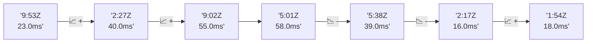

# 📊 Reporte de Performance - PokeAPI

**Fecha de corrida:** 2026-10-12 21:28 UTC

**Enlace:** [38310575436](https://github.com/rba3/Lab_CD_CI_Perfomance/actions/runs/38310575436)

## ✅ Veredicto

```
PASS (fallback por umbrales)

- Error maximo: 0.0%
- p95 maximo: 117.0 ms
```

## 🔮 Predicciones

✓ STABLE

## 📈 Métricas Globales

| Métrica | Valor | SLO | Estado |
|---------|-------|-----|--------|
| Error Rate | 0.0% | < 0.1% | ✅ PASS |
| Latencia p50 | 71.0ms | - | ℹ️ |
| Latencia p95 | 117.0ms | < 800ms | ✅ PASS |
| Latencia p99 | 202.0ms | - | ℹ️ |
| Throughput | 0.00 req/s | - | ℹ️ |
| Muestras | 0 | - | ℹ️ |

## 📉 Tendencia Histórica (Últimas 7 corridas)



## 🔧 Análisis Técnico Detallado (JSON)

```json
{
  "predictions": {
    "prediction": "STABLE",
    "confidence": 0,
    "slope_ms_per_run": -9.25,
    "current_p95": 117.0,
    "days_to_warn": null,
    "days_to_fail": null,
    "risk_level": "LOW"
  },
  "recommendations": [],
  "correlations": {},
  "root_cause": {
    "issue": null,
    "root_cause": null,
    "confidence": 0,
    "evidence": []
  },
  "timestamp": "2026-10-12T21:28:38.927354"
}
```

## 📦 Datos Completos (JSON)

```json
{
  "scenario": "load",
  "overall": {
    "samples": 14247,
    "errors": 0,
    "error_pct": 0.0,
    "avg_ms": 68.9,
    "min_ms": 14,
    "max_ms": 4505,
    "p50_ms": 71.0,
    "p90_ms": 103.0,
    "p95_ms": 117.0,
    "p99_ms": 202.0,
    "throughput_rps": 119.04,
    "duration_s": 119.7
  },
  "by_endpoint": {
    "ability-static": {
      "samples": 1424,
      "errors": 0,
      "error_pct": 0.0,
      "avg_ms": 63.6,
      "min_ms": 16,
      "max_ms": 416,
      "p50_ms": 68.0,
      "p90_ms": 87.0,
      "p95_ms": 91.0,
      "p99_ms": 113.5,
      "throughput_rps": 12.04,
      "duration_s": 118.3
    },
    "berry-cheri": {
      "samples": 1425,
      "errors": 0,
      "error_pct": 0.0,
      "avg_ms": 61.3,
      "min_ms": 15,
      "max_ms": 252,
      "p50_ms": 67.0,
      "p90_ms": 84.0,
      "p95_ms": 89.0,
      "p99_ms": 110.0,
      "throughput_rps": 12.07,
      "duration_s": 118.1
    },
    "generation-1": {
      "samples": 1424,
      "errors": 0,
      "error_pct": 0.0,
      "avg_ms": 65.1,
      "min_ms": 15,
      "max_ms": 412,
      "p50_ms": 74.0,
      "p90_ms": 88.0,
      "p95_ms": 92.0,
      "p99_ms": 114.0,
      "throughput_rps": 12.07,
      "duration_s": 118.0
    },
    "move-tackle": {
      "samples": 1425,
      "errors": 0,
      "error_pct": 0.0,
      "avg_ms": 69.8,
      "min_ms": 15,
      "max_ms": 4505,
      "p50_ms": 74.0,
      "p90_ms": 91.0,
      "p95_ms": 95.0,
      "p99_ms": 119.8,
      "throughput_rps": 12.07,
      "duration_s": 118.1
    },
    "pokemon-charizard": {
      "samples": 1425,
      "errors": 0,
      "error_pct": 0.0,
      "avg_ms": 91.1,
      "min_ms": 18,
      "max_ms": 522,
      "p50_ms": 94.0,
      "p90_ms": 128.0,
      "p95_ms": 175.6,
      "p99_ms": 303.5,
      "throughput_rps": 11.98,
      "duration_s": 119.0
    },
    "pokemon-ditto": {
      "samples": 1425,
      "errors": 0,
      "error_pct": 0.0,
      "avg_ms": 67.1,
      "min_ms": 15,
      "max_ms": 2506,
      "p50_ms": 77.0,
      "p90_ms": 90.0,
      "p95_ms": 93.0,
      "p99_ms": 114.8,
      "throughput_rps": 11.92,
      "duration_s": 119.5
    },
    "pokemon-list": {
      "samples": 1425,
      "errors": 0,
      "error_pct": 0.0,
      "avg_ms": 58.8,
      "min_ms": 14,
      "max_ms": 409,
      "p50_ms": 63.0,
      "p90_ms": 85.0,
      "p95_ms": 89.0,
      "p99_ms": 101.0,
      "throughput_rps": 12.01,
      "duration_s": 118.7
    },
    "pokemon-pikachu": {
      "samples": 1425,
      "errors": 0,
      "error_pct": 0.0,
      "avg_ms": 89.3,
      "min_ms": 18,
      "max_ms": 810,
      "p50_ms": 97.0,
      "p90_ms": 120.0,
      "p95_ms": 136.8,
      "p99_ms": 296.3,
      "throughput_rps": 11.97,
      "duration_s": 119.1
    },
    "type-fire": {
      "samples": 1424,
      "errors": 0,
      "error_pct": 0.0,
      "avg_ms": 60.9,
      "min_ms": 15,
      "max_ms": 248,
      "p50_ms": 67.0,
      "p90_ms": 86.0,
      "p95_ms": 91.0,
      "p99_ms": 104.8,
      "throughput_rps": 12.04,
      "duration_s": 118.3
    },
    "type-water": {
      "samples": 1425,
      "errors": 0,
      "error_pct": 0.0,
      "avg_ms": 62.0,
      "min_ms": 16,
      "max_ms": 418,
      "p50_ms": 66.0,
      "p90_ms": 86.0,
      "p95_ms": 91.0,
      "p99_ms": 110.0,
      "throughput_rps": 12.02,
      "duration_s": 118.5
    }
  },
  "empty": false
}
```

---

*Reporte generado automáticamente por el workflow de performance.*

*Timestamp: 2026-10-12T21:28:38.928990Z*
