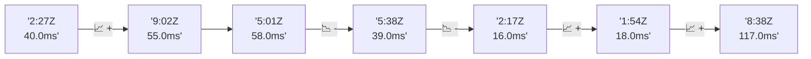

# 📊 Reporte de Performance - PokeAPI

**Fecha de corrida:** 2026-10-13 19:37 UTC

**Enlace:** [38455994318](https://github.com/rba3/Lab_CD_CI_Perfomance/actions/runs/38455994318)

## ✅ Veredicto

```
PASS (fallback por umbrales)

- Error maximo: 0.0%
- p95 maximo: 252.0 ms
```

## 🔮 Predicciones

⚠️ **Tendencia de degradación detectada** (MEDIUM risk)
- Pendiente: +14.75ms/corrida
- P95 actual: 252.0ms
- Días hasta WARN: ~37
- Días hasta FAIL: ~84
- Confianza: 80%

## 📈 Métricas Globales

| Métrica | Valor | SLO | Estado |
|---------|-------|-----|--------|
| Error Rate | 0.0% | < 0.1% | ✅ PASS |
| Latencia p50 | 137.0ms | - | ℹ️ |
| Latencia p95 | 252.0ms | < 800ms | ✅ PASS |
| Latencia p99 | 403.1ms | - | ℹ️ |
| Throughput | 0.00 req/s | - | ℹ️ |
| Muestras | 0 | - | ℹ️ |

## 📉 Tendencia Histórica (Últimas 7 corridas)



## 🔧 Análisis Técnico Detallado (JSON)

```json
{
  "predictions": {
    "prediction": "DEGRADATION_TREND",
    "confidence": 80,
    "slope_ms_per_run": 14.75,
    "current_p95": 252.0,
    "days_to_warn": 37,
    "days_to_fail": 84,
    "risk_level": "MEDIUM"
  },
  "recommendations": [],
  "correlations": {},
  "root_cause": {
    "issue": null,
    "root_cause": null,
    "confidence": 0,
    "evidence": []
  },
  "timestamp": "2026-10-13T19:37:55.918082"
}
```

## 📦 Datos Completos (JSON)

```json
{
  "scenario": "load",
  "overall": {
    "samples": 11648,
    "errors": 0,
    "error_pct": 0.0,
    "avg_ms": 151.4,
    "min_ms": 59,
    "max_ms": 1189,
    "p50_ms": 137.0,
    "p90_ms": 204.0,
    "p95_ms": 252.0,
    "p99_ms": 403.1,
    "throughput_rps": 97.27,
    "duration_s": 119.7
  },
  "by_endpoint": {
    "ability-static": {
      "samples": 1164,
      "errors": 0,
      "error_pct": 0.0,
      "avg_ms": 139.6,
      "min_ms": 60,
      "max_ms": 775,
      "p50_ms": 118.0,
      "p90_ms": 197.0,
      "p95_ms": 198.0,
      "p99_ms": 234.2,
      "throughput_rps": 9.87,
      "duration_s": 117.9
    },
    "berry-cheri": {
      "samples": 1164,
      "errors": 0,
      "error_pct": 0.0,
      "avg_ms": 137.6,
      "min_ms": 59,
      "max_ms": 574,
      "p50_ms": 116.0,
      "p90_ms": 190.0,
      "p95_ms": 191.0,
      "p99_ms": 251.1,
      "throughput_rps": 9.89,
      "duration_s": 117.7
    },
    "generation-1": {
      "samples": 1165,
      "errors": 0,
      "error_pct": 0.0,
      "avg_ms": 137.8,
      "min_ms": 60,
      "max_ms": 583,
      "p50_ms": 117.0,
      "p90_ms": 195.0,
      "p95_ms": 196.0,
      "p99_ms": 216.0,
      "throughput_rps": 9.91,
      "duration_s": 117.5
    },
    "move-tackle": {
      "samples": 1165,
      "errors": 0,
      "error_pct": 0.0,
      "avg_ms": 142.8,
      "min_ms": 62,
      "max_ms": 677,
      "p50_ms": 121.0,
      "p90_ms": 203.0,
      "p95_ms": 204.0,
      "p99_ms": 229.2,
      "throughput_rps": 9.9,
      "duration_s": 117.7
    },
    "pokemon-charizard": {
      "samples": 1165,
      "errors": 0,
      "error_pct": 0.0,
      "avg_ms": 209.3,
      "min_ms": 86,
      "max_ms": 1189,
      "p50_ms": 167.0,
      "p90_ms": 289.0,
      "p95_ms": 346.4,
      "p99_ms": 659.0,
      "throughput_rps": 9.8,
      "duration_s": 118.9
    },
    "pokemon-ditto": {
      "samples": 1165,
      "errors": 0,
      "error_pct": 0.0,
      "avg_ms": 138.7,
      "min_ms": 61,
      "max_ms": 600,
      "p50_ms": 118.0,
      "p90_ms": 199.0,
      "p95_ms": 201.0,
      "p99_ms": 319.4,
      "throughput_rps": 9.74,
      "duration_s": 119.7
    },
    "pokemon-list": {
      "samples": 1165,
      "errors": 0,
      "error_pct": 0.0,
      "avg_ms": 133.2,
      "min_ms": 59,
      "max_ms": 573,
      "p50_ms": 112.0,
      "p90_ms": 190.0,
      "p95_ms": 191.8,
      "p99_ms": 212.4,
      "throughput_rps": 9.82,
      "duration_s": 118.6
    },
    "pokemon-pikachu": {
      "samples": 1165,
      "errors": 0,
      "error_pct": 0.0,
      "avg_ms": 199.6,
      "min_ms": 81,
      "max_ms": 1147,
      "p50_ms": 158.0,
      "p90_ms": 272.0,
      "p95_ms": 344.0,
      "p99_ms": 617.0,
      "throughput_rps": 9.77,
      "duration_s": 119.2
    },
    "type-fire": {
      "samples": 1165,
      "errors": 0,
      "error_pct": 0.0,
      "avg_ms": 140.1,
      "min_ms": 60,
      "max_ms": 587,
      "p50_ms": 117.0,
      "p90_ms": 195.0,
      "p95_ms": 196.0,
      "p99_ms": 303.2,
      "throughput_rps": 9.88,
      "duration_s": 117.9
    },
    "type-water": {
      "samples": 1165,
      "errors": 0,
      "error_pct": 0.0,
      "avg_ms": 135.5,
      "min_ms": 60,
      "max_ms": 490,
      "p50_ms": 116.0,
      "p90_ms": 196.0,
      "p95_ms": 198.0,
      "p99_ms": 260.8,
      "throughput_rps": 9.86,
      "duration_s": 118.1
    }
  },
  "empty": false
}
```

---

*Reporte generado automáticamente por el workflow de performance.*

*Timestamp: 2026-10-13T19:37:55.919592Z*
