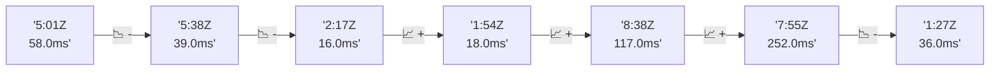

# 📊 Reporte de Performance - PokeAPI

**Fecha de corrida:** 2026-10-15 17:27 UTC

**Enlace:** [38777116004](https://github.com/rba3/Lab_CD_CI_Perfomance/actions/runs/38777116004)

## ✅ Veredicto

```
PASS (fallback por umbrales)

- Error maximo: 0.04%
- p95 maximo: 243.4 ms
```

## 🔮 Predicciones

⚠️ **Tendencia de degradación detectada** (LOW risk)
- Pendiente: +5.0ms/corrida
- P95 actual: 137.0ms
- Días hasta WARN: ~132
- Días hasta FAIL: ~272
- Confianza: 80%

## 📈 Métricas Globales

| Métrica | Valor | SLO | Estado |
|---------|-------|-----|--------|
| Error Rate | 0.04% | < 0.1% | ✅ PASS |
| Latencia p50 | 90.0ms | - | ℹ️ |
| Latencia p95 | 137.0ms | < 800ms | ✅ PASS |
| Latencia p99 | 252.0ms | - | ℹ️ |
| Throughput | 0.00 req/s | - | ℹ️ |
| Muestras | 0 | - | ℹ️ |

## 📉 Tendencia Histórica (Últimas 7 corridas)



## 🔧 Análisis Técnico Detallado (JSON)

```json
{
  "predictions": {
    "prediction": "DEGRADATION_TREND",
    "confidence": 80,
    "slope_ms_per_run": 5.0,
    "current_p95": 137.0,
    "days_to_warn": 132,
    "days_to_fail": 272,
    "risk_level": "LOW"
  },
  "recommendations": [],
  "correlations": {},
  "root_cause": {
    "issue": null,
    "root_cause": null,
    "confidence": 0,
    "evidence": []
  },
  "timestamp": "2026-10-15T17:27:36.471125"
}
```

## 📦 Datos Completos (JSON)

```json
{
  "scenario": "load",
  "overall": {
    "samples": 14206,
    "errors": 5,
    "error_pct": 0.04,
    "avg_ms": 70.0,
    "min_ms": 1,
    "max_ms": 3565,
    "p50_ms": 90.0,
    "p90_ms": 125.0,
    "p95_ms": 137.0,
    "p99_ms": 252.0,
    "throughput_rps": 118.65,
    "duration_s": 119.7
  },
  "by_endpoint": {
    "ability-static": {
      "samples": 1420,
      "errors": 0,
      "error_pct": 0.0,
      "avg_ms": 61.5,
      "min_ms": 9,
      "max_ms": 392,
      "p50_ms": 87.0,
      "p90_ms": 112.0,
      "p95_ms": 117.0,
      "p99_ms": 134.2,
      "throughput_rps": 12.01,
      "duration_s": 118.3
    },
    "berry-cheri": {
      "samples": 1420,
      "errors": 0,
      "error_pct": 0.0,
      "avg_ms": 61.0,
      "min_ms": 9,
      "max_ms": 1092,
      "p50_ms": 87.0,
      "p90_ms": 103.0,
      "p95_ms": 111.0,
      "p99_ms": 150.6,
      "throughput_rps": 12.02,
      "duration_s": 118.1
    },
    "generation-1": {
      "samples": 1420,
      "errors": 0,
      "error_pct": 0.0,
      "avg_ms": 64.1,
      "min_ms": 11,
      "max_ms": 517,
      "p50_ms": 90.0,
      "p90_ms": 110.0,
      "p95_ms": 116.0,
      "p99_ms": 166.8,
      "throughput_rps": 12.04,
      "duration_s": 117.9
    },
    "move-tackle": {
      "samples": 1420,
      "errors": 0,
      "error_pct": 0.0,
      "avg_ms": 66.2,
      "min_ms": 11,
      "max_ms": 496,
      "p50_ms": 93.0,
      "p90_ms": 114.0,
      "p95_ms": 121.0,
      "p99_ms": 200.0,
      "throughput_rps": 12.03,
      "duration_s": 118.0
    },
    "pokemon-charizard": {
      "samples": 1421,
      "errors": 3,
      "error_pct": 0.21,
      "avg_ms": 94.4,
      "min_ms": 1,
      "max_ms": 701,
      "p50_ms": 124.0,
      "p90_ms": 165.0,
      "p95_ms": 192.0,
      "p99_ms": 340.8,
      "throughput_rps": 11.95,
      "duration_s": 118.9
    },
    "pokemon-ditto": {
      "samples": 1421,
      "errors": 0,
      "error_pct": 0.0,
      "avg_ms": 70.1,
      "min_ms": 10,
      "max_ms": 1634,
      "p50_ms": 93.0,
      "p90_ms": 115.0,
      "p95_ms": 119.0,
      "p99_ms": 176.2,
      "throughput_rps": 11.87,
      "duration_s": 119.7
    },
    "pokemon-list": {
      "samples": 1422,
      "errors": 2,
      "error_pct": 0.14,
      "avg_ms": 62.4,
      "min_ms": 9,
      "max_ms": 511,
      "p50_ms": 88.0,
      "p90_ms": 109.0,
      "p95_ms": 114.0,
      "p99_ms": 136.4,
      "throughput_rps": 11.97,
      "duration_s": 118.8
    },
    "pokemon-pikachu": {
      "samples": 1421,
      "errors": 0,
      "error_pct": 0.0,
      "avg_ms": 94.5,
      "min_ms": 11,
      "max_ms": 3565,
      "p50_ms": 119.0,
      "p90_ms": 152.0,
      "p95_ms": 161.0,
      "p99_ms": 311.2,
      "throughput_rps": 11.94,
      "duration_s": 119.1
    },
    "type-fire": {
      "samples": 1420,
      "errors": 0,
      "error_pct": 0.0,
      "avg_ms": 59.9,
      "min_ms": 11,
      "max_ms": 343,
      "p50_ms": 64.0,
      "p90_ms": 111.0,
      "p95_ms": 116.0,
      "p99_ms": 141.4,
      "throughput_rps": 12.0,
      "duration_s": 118.3
    },
    "type-water": {
      "samples": 1421,
      "errors": 0,
      "error_pct": 0.0,
      "avg_ms": 65.6,
      "min_ms": 10,
      "max_ms": 747,
      "p50_ms": 90.0,
      "p90_ms": 113.0,
      "p95_ms": 118.0,
      "p99_ms": 183.0,
      "throughput_rps": 11.98,
      "duration_s": 118.6
    }
  },
  "empty": false
}
```

---

*Reporte generado automáticamente por el workflow de performance.*

*Timestamp: 2026-10-15T17:27:36.472343Z*
