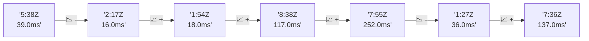

# 📊 Reporte de Performance - PokeAPI

**Fecha de corrida:** 2026-10-16 17:03 UTC

**Enlace:** [38936432471](https://github.com/rba3/Lab_CD_CI_Perfomance/actions/runs/38936432471)

## ✅ Veredicto

```
PASS (fallback por umbrales)

- Error maximo: 0.0%
- p95 maximo: 79.2 ms
```

## 🔮 Predicciones

⚠️ **Tendencia de degradación detectada** (MEDIUM risk)
- Pendiente: +29.75ms/corrida
- P95 actual: 56.0ms
- Días hasta WARN: ~25
- Días hasta FAIL: ~48
- Confianza: 80%

## 📈 Métricas Globales

| Métrica | Valor | SLO | Estado |
|---------|-------|-----|--------|
| Error Rate | 0.0% | < 0.1% | ✅ PASS |
| Latencia p50 | 32.0ms | - | ℹ️ |
| Latencia p95 | 56.0ms | < 800ms | ✅ PASS |
| Latencia p99 | 91.0ms | - | ℹ️ |
| Throughput | 0.00 req/s | - | ℹ️ |
| Muestras | 0 | - | ℹ️ |

## 📉 Tendencia Histórica (Últimas 7 corridas)



## 🔧 Análisis Técnico Detallado (JSON)

```json
{
  "predictions": {
    "prediction": "DEGRADATION_TREND",
    "confidence": 80,
    "slope_ms_per_run": 29.75,
    "current_p95": 56.0,
    "days_to_warn": 25,
    "days_to_fail": 48,
    "risk_level": "MEDIUM"
  },
  "recommendations": [],
  "correlations": {},
  "root_cause": {
    "issue": null,
    "root_cause": null,
    "confidence": 0,
    "evidence": []
  },
  "timestamp": "2026-10-16T17:03:55.431447"
}
```

## 📦 Datos Completos (JSON)

```json
{
  "scenario": "load",
  "overall": {
    "samples": 15535,
    "errors": 0,
    "error_pct": 0.0,
    "avg_ms": 38.3,
    "min_ms": 27,
    "max_ms": 303,
    "p50_ms": 32.0,
    "p90_ms": 49.0,
    "p95_ms": 56.0,
    "p99_ms": 91.0,
    "throughput_rps": 129.88,
    "duration_s": 119.6
  },
  "by_endpoint": {
    "ability-static": {
      "samples": 1553,
      "errors": 0,
      "error_pct": 0.0,
      "avg_ms": 36.7,
      "min_ms": 28,
      "max_ms": 265,
      "p50_ms": 31.0,
      "p90_ms": 48.0,
      "p95_ms": 50.0,
      "p99_ms": 58.5,
      "throughput_rps": 13.14,
      "duration_s": 118.2
    },
    "berry-cheri": {
      "samples": 1553,
      "errors": 0,
      "error_pct": 0.0,
      "avg_ms": 36.3,
      "min_ms": 27,
      "max_ms": 297,
      "p50_ms": 30.0,
      "p90_ms": 47.0,
      "p95_ms": 49.0,
      "p99_ms": 84.0,
      "throughput_rps": 13.14,
      "duration_s": 118.2
    },
    "generation-1": {
      "samples": 1553,
      "errors": 0,
      "error_pct": 0.0,
      "avg_ms": 36.3,
      "min_ms": 28,
      "max_ms": 133,
      "p50_ms": 31.0,
      "p90_ms": 48.0,
      "p95_ms": 50.0,
      "p99_ms": 58.5,
      "throughput_rps": 13.17,
      "duration_s": 117.9
    },
    "move-tackle": {
      "samples": 1554,
      "errors": 0,
      "error_pct": 0.0,
      "avg_ms": 38.3,
      "min_ms": 29,
      "max_ms": 183,
      "p50_ms": 33.0,
      "p90_ms": 50.0,
      "p95_ms": 52.0,
      "p99_ms": 61.0,
      "throughput_rps": 13.16,
      "duration_s": 118.1
    },
    "pokemon-charizard": {
      "samples": 1553,
      "errors": 0,
      "error_pct": 0.0,
      "avg_ms": 48.5,
      "min_ms": 36,
      "max_ms": 278,
      "p50_ms": 42.0,
      "p90_ms": 65.0,
      "p95_ms": 75.4,
      "p99_ms": 166.0,
      "throughput_rps": 13.06,
      "duration_s": 118.9
    },
    "pokemon-ditto": {
      "samples": 1554,
      "errors": 0,
      "error_pct": 0.0,
      "avg_ms": 37.0,
      "min_ms": 28,
      "max_ms": 303,
      "p50_ms": 32.0,
      "p90_ms": 49.0,
      "p95_ms": 51.3,
      "p99_ms": 89.5,
      "throughput_rps": 12.99,
      "duration_s": 119.6
    },
    "pokemon-list": {
      "samples": 1553,
      "errors": 0,
      "error_pct": 0.0,
      "avg_ms": 32.7,
      "min_ms": 27,
      "max_ms": 179,
      "p50_ms": 30.0,
      "p90_ms": 45.0,
      "p95_ms": 48.0,
      "p99_ms": 55.0,
      "throughput_rps": 13.1,
      "duration_s": 118.5
    },
    "pokemon-pikachu": {
      "samples": 1554,
      "errors": 0,
      "error_pct": 0.0,
      "avg_ms": 46.5,
      "min_ms": 35,
      "max_ms": 280,
      "p50_ms": 40.0,
      "p90_ms": 62.0,
      "p95_ms": 69.0,
      "p99_ms": 159.9,
      "throughput_rps": 13.05,
      "duration_s": 119.1
    },
    "type-fire": {
      "samples": 1554,
      "errors": 0,
      "error_pct": 0.0,
      "avg_ms": 35.3,
      "min_ms": 28,
      "max_ms": 171,
      "p50_ms": 31.0,
      "p90_ms": 47.0,
      "p95_ms": 50.0,
      "p99_ms": 59.0,
      "throughput_rps": 13.11,
      "duration_s": 118.5
    },
    "type-water": {
      "samples": 1554,
      "errors": 0,
      "error_pct": 0.0,
      "avg_ms": 35.0,
      "min_ms": 28,
      "max_ms": 205,
      "p50_ms": 31.0,
      "p90_ms": 47.0,
      "p95_ms": 49.0,
      "p99_ms": 58.5,
      "throughput_rps": 13.11,
      "duration_s": 118.6
    }
  },
  "empty": false
}
```

---

*Reporte generado automáticamente por el workflow de performance.*

*Timestamp: 2026-10-16T17:03:55.432825Z*
