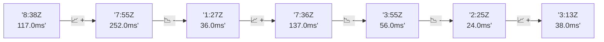

# 📊 Reporte de Performance - PokeAPI

**Fecha de corrida:** 2026-10-19 18:54 UTC

**Enlace:** [39306062603](https://github.com/rba3/Lab_CD_CI_Perfomance/actions/runs/39306062603)

## ✅ Veredicto

```
PASS (fallback por umbrales)

- Error maximo: 0.08%
- p95 maximo: 130.5 ms
```

## 🔮 Predicciones

⚠️ **Tendencia de degradación detectada** (LOW risk)
- Pendiente: +0.5ms/corrida
- P95 actual: 122.0ms
- Días hasta WARN: ~1356
- Días hasta FAIL: ~2756
- Confianza: 80%

## 🎯 Causa Raíz Identificada

**Latencia inconsistente (outliers)**
- Causa probable: Spikes de latencia, posible GC o context switching
- Confianza: 75%
- Evidencia:
  - p50 (26.0ms) mucho menor que p95 (122.0ms)
  - Diferencia de 3x+ indica distribución anómala

## 📈 Métricas Globales

| Métrica | Valor | SLO | Estado |
|---------|-------|-----|--------|
| Error Rate | 0.08% | < 0.1% | ✅ PASS |
| Latencia p50 | 26.0ms | - | ℹ️ |
| Latencia p95 | 122.0ms | < 800ms | ✅ PASS |
| Latencia p99 | 140.0ms | - | ℹ️ |
| Throughput | 0.00 req/s | - | ℹ️ |
| Muestras | 0 | - | ℹ️ |

## 📉 Tendencia Histórica (Últimas 7 corridas)



## 🔧 Análisis Técnico Detallado (JSON)

```json
{
  "predictions": {
    "prediction": "DEGRADATION_TREND",
    "confidence": 80,
    "slope_ms_per_run": 0.5,
    "current_p95": 122.0,
    "days_to_warn": 1356,
    "days_to_fail": 2756,
    "risk_level": "LOW"
  },
  "recommendations": [],
  "correlations": {},
  "root_cause": {
    "issue": "Latencia inconsistente (outliers)",
    "root_cause": "Spikes de latencia, posible GC o context switching",
    "confidence": 75,
    "evidence": [
      "p50 (26.0ms) mucho menor que p95 (122.0ms)",
      "Diferencia de 3x+ indica distribuci\u00f3n an\u00f3mala"
    ]
  },
  "timestamp": "2026-10-19T18:54:21.810567"
}
```

## 📦 Datos Completos (JSON)

```json
{
  "scenario": "load",
  "overall": {
    "samples": 15192,
    "errors": 12,
    "error_pct": 0.08,
    "avg_ms": 45.8,
    "min_ms": 1,
    "max_ms": 541,
    "p50_ms": 26.0,
    "p90_ms": 99.0,
    "p95_ms": 122.0,
    "p99_ms": 140.0,
    "throughput_rps": 127.02,
    "duration_s": 119.6
  },
  "by_endpoint": {
    "ability-static": {
      "samples": 1519,
      "errors": 2,
      "error_pct": 0.13,
      "avg_ms": 42.4,
      "min_ms": 3,
      "max_ms": 278,
      "p50_ms": 26.0,
      "p90_ms": 96.0,
      "p95_ms": 99.0,
      "p99_ms": 109.0,
      "throughput_rps": 12.83,
      "duration_s": 118.4
    },
    "berry-cheri": {
      "samples": 1519,
      "errors": 1,
      "error_pct": 0.07,
      "avg_ms": 39.4,
      "min_ms": 7,
      "max_ms": 269,
      "p50_ms": 23.0,
      "p90_ms": 93.0,
      "p95_ms": 96.0,
      "p99_ms": 105.0,
      "throughput_rps": 12.84,
      "duration_s": 118.3
    },
    "generation-1": {
      "samples": 1519,
      "errors": 0,
      "error_pct": 0.0,
      "avg_ms": 41.2,
      "min_ms": 9,
      "max_ms": 277,
      "p50_ms": 24.0,
      "p90_ms": 96.0,
      "p95_ms": 100.0,
      "p99_ms": 113.8,
      "throughput_rps": 12.87,
      "duration_s": 118.1
    },
    "move-tackle": {
      "samples": 1519,
      "errors": 3,
      "error_pct": 0.2,
      "avg_ms": 41.0,
      "min_ms": 3,
      "max_ms": 124,
      "p50_ms": 26.0,
      "p90_ms": 98.0,
      "p95_ms": 100.0,
      "p99_ms": 112.0,
      "throughput_rps": 12.86,
      "duration_s": 118.1
    },
    "pokemon-charizard": {
      "samples": 1519,
      "errors": 1,
      "error_pct": 0.07,
      "avg_ms": 61.8,
      "min_ms": 9,
      "max_ms": 541,
      "p50_ms": 32.0,
      "p90_ms": 135.0,
      "p95_ms": 139.0,
      "p99_ms": 285.5,
      "throughput_rps": 12.76,
      "duration_s": 119.0
    },
    "pokemon-ditto": {
      "samples": 1520,
      "errors": 1,
      "error_pct": 0.07,
      "avg_ms": 41.6,
      "min_ms": 1,
      "max_ms": 396,
      "p50_ms": 24.0,
      "p90_ms": 97.0,
      "p95_ms": 100.0,
      "p99_ms": 115.6,
      "throughput_rps": 12.71,
      "duration_s": 119.6
    },
    "pokemon-list": {
      "samples": 1519,
      "errors": 1,
      "error_pct": 0.07,
      "avg_ms": 44.2,
      "min_ms": 3,
      "max_ms": 260,
      "p50_ms": 24.0,
      "p90_ms": 94.0,
      "p95_ms": 96.0,
      "p99_ms": 104.0,
      "throughput_rps": 12.8,
      "duration_s": 118.7
    },
    "pokemon-pikachu": {
      "samples": 1520,
      "errors": 3,
      "error_pct": 0.2,
      "avg_ms": 58.5,
      "min_ms": 2,
      "max_ms": 518,
      "p50_ms": 32.0,
      "p90_ms": 128.0,
      "p95_ms": 132.0,
      "p99_ms": 193.8,
      "throughput_rps": 12.76,
      "duration_s": 119.1
    },
    "type-fire": {
      "samples": 1519,
      "errors": 0,
      "error_pct": 0.0,
      "avg_ms": 43.6,
      "min_ms": 10,
      "max_ms": 296,
      "p50_ms": 25.0,
      "p90_ms": 96.0,
      "p95_ms": 99.0,
      "p99_ms": 112.6,
      "throughput_rps": 12.83,
      "duration_s": 118.4
    },
    "type-water": {
      "samples": 1519,
      "errors": 0,
      "error_pct": 0.0,
      "avg_ms": 44.8,
      "min_ms": 9,
      "max_ms": 295,
      "p50_ms": 25.0,
      "p90_ms": 96.0,
      "p95_ms": 99.0,
      "p99_ms": 110.0,
      "throughput_rps": 12.81,
      "duration_s": 118.6
    }
  },
  "empty": false
}
```

---

*Reporte generado automáticamente por el workflow de performance.*

*Timestamp: 2026-10-19T18:54:21.811685Z*
