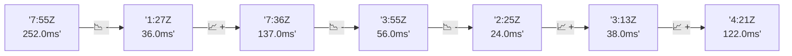

# 📊 Reporte de Performance - PokeAPI

**Fecha de corrida:** 2026-10-20 17:38 UTC

**Enlace:** [39467379416](https://github.com/rba3/Lab_CD_CI_Perfomance/actions/runs/39467379416)

## ✅ Veredicto

```
PASS (fallback por umbrales)

- Error maximo: 0.0%
- p95 maximo: 74.0 ms
```

## 🔮 Predicciones

✓ STABLE

## 📈 Métricas Globales

| Métrica | Valor | SLO | Estado |
|---------|-------|-----|--------|
| Error Rate | 0.0% | < 0.1% | ✅ PASS |
| Latencia p50 | 41.0ms | - | ℹ️ |
| Latencia p95 | 74.0ms | < 800ms | ✅ PASS |
| Latencia p99 | 103.0ms | - | ℹ️ |
| Throughput | 0.00 req/s | - | ℹ️ |
| Muestras | 0 | - | ℹ️ |

## 📉 Tendencia Histórica (Últimas 7 corridas)



## 🔧 Análisis Técnico Detallado (JSON)

```json
{
  "predictions": {
    "prediction": "STABLE",
    "confidence": 0,
    "slope_ms_per_run": -3.75,
    "current_p95": 74.0,
    "days_to_warn": null,
    "days_to_fail": null,
    "risk_level": "LOW"
  },
  "recommendations": [],
  "correlations": {},
  "root_cause": {
    "issue": null,
    "root_cause": null,
    "confidence": 0,
    "evidence": []
  },
  "timestamp": "2026-10-20T17:38:04.186289"
}
```

## 📦 Datos Completos (JSON)

```json
{
  "scenario": "load",
  "overall": {
    "samples": 15176,
    "errors": 0,
    "error_pct": 0.0,
    "avg_ms": 46.3,
    "min_ms": 26,
    "max_ms": 897,
    "p50_ms": 41.0,
    "p90_ms": 65.0,
    "p95_ms": 74.0,
    "p99_ms": 103.0,
    "throughput_rps": 126.8,
    "duration_s": 119.7
  },
  "by_endpoint": {
    "ability-static": {
      "samples": 1517,
      "errors": 0,
      "error_pct": 0.0,
      "avg_ms": 44.5,
      "min_ms": 26,
      "max_ms": 330,
      "p50_ms": 38.0,
      "p90_ms": 61.0,
      "p95_ms": 66.0,
      "p99_ms": 80.7,
      "throughput_rps": 12.82,
      "duration_s": 118.4
    },
    "berry-cheri": {
      "samples": 1517,
      "errors": 0,
      "error_pct": 0.0,
      "avg_ms": 43.2,
      "min_ms": 26,
      "max_ms": 278,
      "p50_ms": 37.0,
      "p90_ms": 59.0,
      "p95_ms": 64.0,
      "p99_ms": 73.0,
      "throughput_rps": 12.84,
      "duration_s": 118.2
    },
    "generation-1": {
      "samples": 1518,
      "errors": 0,
      "error_pct": 0.0,
      "avg_ms": 44.2,
      "min_ms": 26,
      "max_ms": 213,
      "p50_ms": 38.0,
      "p90_ms": 62.0,
      "p95_ms": 68.0,
      "p99_ms": 87.8,
      "throughput_rps": 12.86,
      "duration_s": 118.1
    },
    "move-tackle": {
      "samples": 1518,
      "errors": 0,
      "error_pct": 0.0,
      "avg_ms": 47.2,
      "min_ms": 27,
      "max_ms": 444,
      "p50_ms": 40.0,
      "p90_ms": 65.0,
      "p95_ms": 70.0,
      "p99_ms": 81.8,
      "throughput_rps": 12.85,
      "duration_s": 118.2
    },
    "pokemon-charizard": {
      "samples": 1518,
      "errors": 0,
      "error_pct": 0.0,
      "avg_ms": 58.9,
      "min_ms": 37,
      "max_ms": 340,
      "p50_ms": 49.0,
      "p90_ms": 86.0,
      "p95_ms": 98.1,
      "p99_ms": 163.8,
      "throughput_rps": 12.74,
      "duration_s": 119.1
    },
    "pokemon-ditto": {
      "samples": 1518,
      "errors": 0,
      "error_pct": 0.0,
      "avg_ms": 44.1,
      "min_ms": 27,
      "max_ms": 245,
      "p50_ms": 37.0,
      "p90_ms": 62.0,
      "p95_ms": 68.0,
      "p99_ms": 88.7,
      "throughput_rps": 12.69,
      "duration_s": 119.6
    },
    "pokemon-list": {
      "samples": 1517,
      "errors": 0,
      "error_pct": 0.0,
      "avg_ms": 40.2,
      "min_ms": 26,
      "max_ms": 202,
      "p50_ms": 35.0,
      "p90_ms": 57.0,
      "p95_ms": 62.0,
      "p99_ms": 71.0,
      "throughput_rps": 12.79,
      "duration_s": 118.6
    },
    "pokemon-pikachu": {
      "samples": 1518,
      "errors": 0,
      "error_pct": 0.0,
      "avg_ms": 56.5,
      "min_ms": 32,
      "max_ms": 897,
      "p50_ms": 47.0,
      "p90_ms": 82.0,
      "p95_ms": 94.0,
      "p99_ms": 166.5,
      "throughput_rps": 12.75,
      "duration_s": 119.1
    },
    "type-fire": {
      "samples": 1518,
      "errors": 0,
      "error_pct": 0.0,
      "avg_ms": 42.6,
      "min_ms": 27,
      "max_ms": 205,
      "p50_ms": 37.0,
      "p90_ms": 59.0,
      "p95_ms": 66.0,
      "p99_ms": 75.0,
      "throughput_rps": 12.81,
      "duration_s": 118.5
    },
    "type-water": {
      "samples": 1517,
      "errors": 0,
      "error_pct": 0.0,
      "avg_ms": 42.1,
      "min_ms": 27,
      "max_ms": 200,
      "p50_ms": 37.0,
      "p90_ms": 59.4,
      "p95_ms": 64.0,
      "p99_ms": 74.0,
      "throughput_rps": 12.8,
      "duration_s": 118.5
    }
  },
  "empty": false
}
```

---

*Reporte generado automáticamente por el workflow de performance.*

*Timestamp: 2026-10-20T17:38:04.187346Z*
