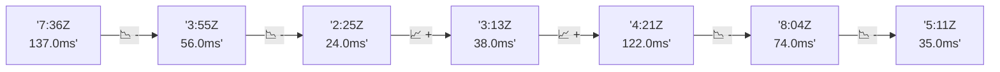

# 📊 Reporte de Performance - PokeAPI

**Fecha de corrida:** 2026-10-22 17:43 UTC

**Enlace:** [39824831556](https://github.com/rba3/Lab_CD_CI_Perfomance/actions/runs/39824831556)

## ✅ Veredicto

```
PASS (fallback por umbrales)

- Error maximo: 0.0%
- p95 maximo: 46.0 ms
```

## 🔮 Predicciones

⚠️ **Tendencia de degradación detectada** (LOW risk)
- Pendiente: +2.75ms/corrida
- P95 actual: 34.0ms
- Días hasta WARN: ~278
- Días hasta FAIL: ~533
- Confianza: 80%

## 📈 Métricas Globales

| Métrica | Valor | SLO | Estado |
|---------|-------|-----|--------|
| Error Rate | 0.0% | < 0.1% | ✅ PASS |
| Latencia p50 | 22.0ms | - | ℹ️ |
| Latencia p95 | 34.0ms | < 800ms | ✅ PASS |
| Latencia p99 | 49.6ms | - | ℹ️ |
| Throughput | 0.00 req/s | - | ℹ️ |
| Muestras | 0 | - | ℹ️ |

## 📉 Tendencia Histórica (Últimas 7 corridas)



## 🔧 Análisis Técnico Detallado (JSON)

```json
{
  "predictions": {
    "prediction": "DEGRADATION_TREND",
    "confidence": 80,
    "slope_ms_per_run": 2.75,
    "current_p95": 34.0,
    "days_to_warn": 278,
    "days_to_fail": 533,
    "risk_level": "LOW"
  },
  "recommendations": [],
  "correlations": {},
  "root_cause": {
    "issue": null,
    "root_cause": null,
    "confidence": 0,
    "evidence": []
  },
  "timestamp": "2026-10-22T17:43:59.589412"
}
```

## 📦 Datos Completos (JSON)

```json
{
  "scenario": "load",
  "overall": {
    "samples": 16245,
    "errors": 0,
    "error_pct": 0.0,
    "avg_ms": 23.5,
    "min_ms": 14,
    "max_ms": 200,
    "p50_ms": 22.0,
    "p90_ms": 30.0,
    "p95_ms": 34.0,
    "p99_ms": 49.6,
    "throughput_rps": 135.79,
    "duration_s": 119.6
  },
  "by_endpoint": {
    "ability-static": {
      "samples": 1624,
      "errors": 0,
      "error_pct": 0.0,
      "avg_ms": 22.9,
      "min_ms": 16,
      "max_ms": 94,
      "p50_ms": 22.0,
      "p90_ms": 29.0,
      "p95_ms": 32.8,
      "p99_ms": 40.0,
      "throughput_rps": 13.71,
      "duration_s": 118.4
    },
    "berry-cheri": {
      "samples": 1625,
      "errors": 0,
      "error_pct": 0.0,
      "avg_ms": 22.6,
      "min_ms": 14,
      "max_ms": 105,
      "p50_ms": 21.0,
      "p90_ms": 31.0,
      "p95_ms": 33.0,
      "p99_ms": 44.0,
      "throughput_rps": 13.73,
      "duration_s": 118.4
    },
    "generation-1": {
      "samples": 1624,
      "errors": 0,
      "error_pct": 0.0,
      "avg_ms": 22.4,
      "min_ms": 15,
      "max_ms": 89,
      "p50_ms": 21.0,
      "p90_ms": 30.0,
      "p95_ms": 33.0,
      "p99_ms": 44.0,
      "throughput_rps": 13.75,
      "duration_s": 118.1
    },
    "move-tackle": {
      "samples": 1625,
      "errors": 0,
      "error_pct": 0.0,
      "avg_ms": 23.9,
      "min_ms": 15,
      "max_ms": 174,
      "p50_ms": 22.0,
      "p90_ms": 31.0,
      "p95_ms": 35.0,
      "p99_ms": 45.8,
      "throughput_rps": 13.76,
      "duration_s": 118.1
    },
    "pokemon-charizard": {
      "samples": 1625,
      "errors": 0,
      "error_pct": 0.0,
      "avg_ms": 27.7,
      "min_ms": 19,
      "max_ms": 109,
      "p50_ms": 26.0,
      "p90_ms": 33.0,
      "p95_ms": 41.0,
      "p99_ms": 60.8,
      "throughput_rps": 13.65,
      "duration_s": 119.1
    },
    "pokemon-ditto": {
      "samples": 1625,
      "errors": 0,
      "error_pct": 0.0,
      "avg_ms": 23.1,
      "min_ms": 15,
      "max_ms": 200,
      "p50_ms": 21.0,
      "p90_ms": 32.0,
      "p95_ms": 35.0,
      "p99_ms": 41.0,
      "throughput_rps": 13.58,
      "duration_s": 119.6
    },
    "pokemon-list": {
      "samples": 1624,
      "errors": 0,
      "error_pct": 0.0,
      "avg_ms": 22.2,
      "min_ms": 16,
      "max_ms": 166,
      "p50_ms": 21.0,
      "p90_ms": 27.0,
      "p95_ms": 30.0,
      "p99_ms": 44.5,
      "throughput_rps": 13.68,
      "duration_s": 118.7
    },
    "pokemon-pikachu": {
      "samples": 1625,
      "errors": 0,
      "error_pct": 0.0,
      "avg_ms": 26.0,
      "min_ms": 17,
      "max_ms": 177,
      "p50_ms": 24.0,
      "p90_ms": 32.0,
      "p95_ms": 41.0,
      "p99_ms": 58.8,
      "throughput_rps": 13.64,
      "duration_s": 119.1
    },
    "type-fire": {
      "samples": 1624,
      "errors": 0,
      "error_pct": 0.0,
      "avg_ms": 23.0,
      "min_ms": 15,
      "max_ms": 76,
      "p50_ms": 22.0,
      "p90_ms": 28.0,
      "p95_ms": 32.0,
      "p99_ms": 40.8,
      "throughput_rps": 13.71,
      "duration_s": 118.5
    },
    "type-water": {
      "samples": 1624,
      "errors": 0,
      "error_pct": 0.0,
      "avg_ms": 21.7,
      "min_ms": 15,
      "max_ms": 85,
      "p50_ms": 21.0,
      "p90_ms": 25.0,
      "p95_ms": 29.0,
      "p99_ms": 41.8,
      "throughput_rps": 13.69,
      "duration_s": 118.6
    }
  },
  "empty": false
}
```

---

*Reporte generado automáticamente por el workflow de performance.*

*Timestamp: 2026-10-22T17:43:59.590343Z*
