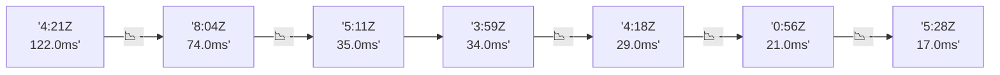

# 📊 Reporte de Performance - PokeAPI

**Fecha de corrida:** 2026-10-26 18:56 UTC

**Enlace:** [40381816812](https://github.com/rba3/Lab_CD_CI_Perfomance/actions/runs/40381816812)

## ✅ Veredicto

```
PASS (fallback por umbrales)

- Error maximo: 0.0%
- p95 maximo: 61.0 ms
```

## 🔮 Predicciones

✓ STABLE

## 📈 Métricas Globales

| Métrica | Valor | SLO | Estado |
|---------|-------|-----|--------|
| Error Rate | 0.0% | < 0.1% | ✅ PASS |
| Latencia p50 | 27.0ms | - | ℹ️ |
| Latencia p95 | 61.0ms | < 800ms | ✅ PASS |
| Latencia p99 | 94.1ms | - | ℹ️ |
| Throughput | 0.00 req/s | - | ℹ️ |
| Muestras | 0 | - | ℹ️ |

## 📉 Tendencia Histórica (Últimas 7 corridas)



## 🔧 Análisis Técnico Detallado (JSON)

```json
{
  "predictions": {
    "prediction": "STABLE",
    "confidence": 0,
    "slope_ms_per_run": -4.5,
    "current_p95": 61.0,
    "days_to_warn": null,
    "days_to_fail": null,
    "risk_level": "LOW"
  },
  "recommendations": [],
  "correlations": {},
  "root_cause": {
    "issue": null,
    "root_cause": null,
    "confidence": 0,
    "evidence": []
  },
  "timestamp": "2026-10-26T18:56:36.845429"
}
```

## 📦 Datos Completos (JSON)

```json
{
  "scenario": "load",
  "overall": {
    "samples": 15791,
    "errors": 0,
    "error_pct": 0.0,
    "avg_ms": 32.8,
    "min_ms": 12,
    "max_ms": 2969,
    "p50_ms": 27.0,
    "p90_ms": 51.0,
    "p95_ms": 61.0,
    "p99_ms": 94.1,
    "throughput_rps": 132.0,
    "duration_s": 119.6
  },
  "by_endpoint": {
    "ability-static": {
      "samples": 1579,
      "errors": 0,
      "error_pct": 0.0,
      "avg_ms": 33.9,
      "min_ms": 13,
      "max_ms": 2537,
      "p50_ms": 26.0,
      "p90_ms": 49.0,
      "p95_ms": 53.0,
      "p99_ms": 124.1,
      "throughput_rps": 13.34,
      "duration_s": 118.3
    },
    "berry-cheri": {
      "samples": 1579,
      "errors": 0,
      "error_pct": 0.0,
      "avg_ms": 29.5,
      "min_ms": 12,
      "max_ms": 266,
      "p50_ms": 24.0,
      "p90_ms": 48.0,
      "p95_ms": 52.0,
      "p99_ms": 68.0,
      "throughput_rps": 13.34,
      "duration_s": 118.3
    },
    "generation-1": {
      "samples": 1579,
      "errors": 0,
      "error_pct": 0.0,
      "avg_ms": 30.3,
      "min_ms": 12,
      "max_ms": 260,
      "p50_ms": 24.0,
      "p90_ms": 50.0,
      "p95_ms": 53.0,
      "p99_ms": 70.2,
      "throughput_rps": 13.38,
      "duration_s": 118.0
    },
    "move-tackle": {
      "samples": 1579,
      "errors": 0,
      "error_pct": 0.0,
      "avg_ms": 33.1,
      "min_ms": 13,
      "max_ms": 965,
      "p50_ms": 28.0,
      "p90_ms": 51.0,
      "p95_ms": 56.0,
      "p99_ms": 71.4,
      "throughput_rps": 13.37,
      "duration_s": 118.1
    },
    "pokemon-charizard": {
      "samples": 1580,
      "errors": 0,
      "error_pct": 0.0,
      "avg_ms": 39.9,
      "min_ms": 17,
      "max_ms": 684,
      "p50_ms": 33.0,
      "p90_ms": 66.0,
      "p95_ms": 75.0,
      "p99_ms": 128.4,
      "throughput_rps": 13.27,
      "duration_s": 119.0
    },
    "pokemon-ditto": {
      "samples": 1579,
      "errors": 0,
      "error_pct": 0.0,
      "avg_ms": 31.5,
      "min_ms": 13,
      "max_ms": 1303,
      "p50_ms": 26.0,
      "p90_ms": 50.0,
      "p95_ms": 53.1,
      "p99_ms": 74.2,
      "throughput_rps": 13.21,
      "duration_s": 119.5
    },
    "pokemon-list": {
      "samples": 1579,
      "errors": 0,
      "error_pct": 0.0,
      "avg_ms": 28.6,
      "min_ms": 12,
      "max_ms": 269,
      "p50_ms": 24.0,
      "p90_ms": 47.0,
      "p95_ms": 52.0,
      "p99_ms": 67.2,
      "throughput_rps": 13.31,
      "duration_s": 118.6
    },
    "pokemon-pikachu": {
      "samples": 1579,
      "errors": 0,
      "error_pct": 0.0,
      "avg_ms": 41.0,
      "min_ms": 15,
      "max_ms": 2969,
      "p50_ms": 31.0,
      "p90_ms": 64.0,
      "p95_ms": 83.0,
      "p99_ms": 145.4,
      "throughput_rps": 13.26,
      "duration_s": 119.0
    },
    "type-fire": {
      "samples": 1579,
      "errors": 0,
      "error_pct": 0.0,
      "avg_ms": 31.0,
      "min_ms": 12,
      "max_ms": 1077,
      "p50_ms": 26.0,
      "p90_ms": 48.0,
      "p95_ms": 53.0,
      "p99_ms": 74.2,
      "throughput_rps": 13.32,
      "duration_s": 118.5
    },
    "type-water": {
      "samples": 1579,
      "errors": 0,
      "error_pct": 0.0,
      "avg_ms": 29.3,
      "min_ms": 13,
      "max_ms": 257,
      "p50_ms": 25.0,
      "p90_ms": 48.0,
      "p95_ms": 51.0,
      "p99_ms": 67.2,
      "throughput_rps": 13.31,
      "duration_s": 118.7
    }
  },
  "empty": false
}
```

---

*Reporte generado automáticamente por el workflow de performance.*

*Timestamp: 2026-10-26T18:56:36.846883Z*
