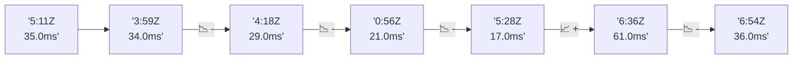

# 📊 Reporte de Performance - PokeAPI

**Fecha de corrida:** 2026-10-28 18:35 UTC

**Enlace:** [40746028383](https://github.com/rba3/Lab_CD_CI_Perfomance/actions/runs/40746028383)

## ✅ Veredicto

```
PASS (fallback por umbrales)

- Error maximo: 0.0%
- p95 maximo: 264.9 ms
```

## 🔮 Predicciones

⚠️ **Tendencia de degradación detectada** (LOW risk)
- Pendiente: +1.75ms/corrida
- P95 actual: 224.0ms
- Días hasta WARN: ~329
- Días hasta FAIL: ~729
- Confianza: 80%

## 📈 Métricas Globales

| Métrica | Valor | SLO | Estado |
|---------|-------|-----|--------|
| Error Rate | 0.0% | < 0.1% | ✅ PASS |
| Latencia p50 | 153.0ms | - | ℹ️ |
| Latencia p95 | 224.0ms | < 800ms | ✅ PASS |
| Latencia p99 | 438.0ms | - | ℹ️ |
| Throughput | 0.00 req/s | - | ℹ️ |
| Muestras | 0 | - | ℹ️ |

## 📉 Tendencia Histórica (Últimas 7 corridas)



## 🔧 Análisis Técnico Detallado (JSON)

```json
{
  "predictions": {
    "prediction": "DEGRADATION_TREND",
    "confidence": 80,
    "slope_ms_per_run": 1.75,
    "current_p95": 224.0,
    "days_to_warn": 329,
    "days_to_fail": 729,
    "risk_level": "LOW"
  },
  "recommendations": [],
  "correlations": {},
  "root_cause": {
    "issue": null,
    "root_cause": null,
    "confidence": 0,
    "evidence": []
  },
  "timestamp": "2026-10-28T18:35:02.533179"
}
```

## 📦 Datos Completos (JSON)

```json
{
  "scenario": "load",
  "overall": {
    "samples": 11206,
    "errors": 0,
    "error_pct": 0.0,
    "avg_ms": 169.4,
    "min_ms": 138,
    "max_ms": 865,
    "p50_ms": 153.0,
    "p90_ms": 216.0,
    "p95_ms": 224.0,
    "p99_ms": 438.0,
    "throughput_rps": 93.54,
    "duration_s": 119.8
  },
  "by_endpoint": {
    "ability-static": {
      "samples": 1120,
      "errors": 0,
      "error_pct": 0.0,
      "avg_ms": 154.4,
      "min_ms": 143,
      "max_ms": 478,
      "p50_ms": 151.0,
      "p90_ms": 157.0,
      "p95_ms": 162.0,
      "p99_ms": 202.7,
      "throughput_rps": 9.5,
      "duration_s": 117.9
    },
    "berry-cheri": {
      "samples": 1120,
      "errors": 0,
      "error_pct": 0.0,
      "avg_ms": 150.3,
      "min_ms": 138,
      "max_ms": 445,
      "p50_ms": 147.0,
      "p90_ms": 152.0,
      "p95_ms": 154.0,
      "p99_ms": 377.2,
      "throughput_rps": 9.51,
      "duration_s": 117.8
    },
    "generation-1": {
      "samples": 1121,
      "errors": 0,
      "error_pct": 0.0,
      "avg_ms": 153.3,
      "min_ms": 141,
      "max_ms": 452,
      "p50_ms": 151.0,
      "p90_ms": 158.0,
      "p95_ms": 162.0,
      "p99_ms": 171.0,
      "throughput_rps": 9.54,
      "duration_s": 117.5
    },
    "move-tackle": {
      "samples": 1120,
      "errors": 0,
      "error_pct": 0.0,
      "avg_ms": 161.9,
      "min_ms": 146,
      "max_ms": 476,
      "p50_ms": 158.0,
      "p90_ms": 169.0,
      "p95_ms": 182.0,
      "p99_ms": 190.8,
      "throughput_rps": 9.52,
      "duration_s": 117.6
    },
    "pokemon-charizard": {
      "samples": 1121,
      "errors": 0,
      "error_pct": 0.0,
      "avg_ms": 231.0,
      "min_ms": 188,
      "max_ms": 865,
      "p50_ms": 221.0,
      "p90_ms": 238.0,
      "p95_ms": 269.0,
      "p99_ms": 519.6,
      "throughput_rps": 9.43,
      "duration_s": 118.8
    },
    "pokemon-ditto": {
      "samples": 1121,
      "errors": 0,
      "error_pct": 0.0,
      "avg_ms": 157.5,
      "min_ms": 143,
      "max_ms": 662,
      "p50_ms": 154.0,
      "p90_ms": 163.0,
      "p95_ms": 172.0,
      "p99_ms": 183.0,
      "throughput_rps": 9.37,
      "duration_s": 119.7
    },
    "pokemon-list": {
      "samples": 1121,
      "errors": 0,
      "error_pct": 0.0,
      "avg_ms": 149.6,
      "min_ms": 139,
      "max_ms": 447,
      "p50_ms": 146.0,
      "p90_ms": 151.0,
      "p95_ms": 153.0,
      "p99_ms": 372.4,
      "throughput_rps": 9.45,
      "duration_s": 118.6
    },
    "pokemon-pikachu": {
      "samples": 1121,
      "errors": 0,
      "error_pct": 0.0,
      "avg_ms": 227.0,
      "min_ms": 180,
      "max_ms": 832,
      "p50_ms": 209.0,
      "p90_ms": 231.0,
      "p95_ms": 393.0,
      "p99_ms": 814.8,
      "throughput_rps": 9.4,
      "duration_s": 119.3
    },
    "type-fire": {
      "samples": 1120,
      "errors": 0,
      "error_pct": 0.0,
      "avg_ms": 154.3,
      "min_ms": 141,
      "max_ms": 458,
      "p50_ms": 150.0,
      "p90_ms": 156.0,
      "p95_ms": 160.0,
      "p99_ms": 427.0,
      "throughput_rps": 9.5,
      "duration_s": 118.0
    },
    "type-water": {
      "samples": 1121,
      "errors": 0,
      "error_pct": 0.0,
      "avg_ms": 154.6,
      "min_ms": 142,
      "max_ms": 458,
      "p50_ms": 151.0,
      "p90_ms": 157.0,
      "p95_ms": 162.0,
      "p99_ms": 271.8,
      "throughput_rps": 9.49,
      "duration_s": 118.1
    }
  },
  "empty": false
}
```

---

*Reporte generado automáticamente por el workflow de performance.*

*Timestamp: 2026-10-28T18:35:02.534559Z*
