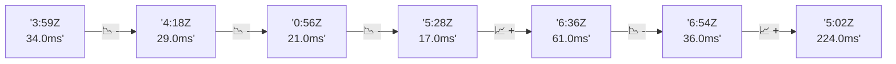

# 📊 Reporte de Performance - PokeAPI

**Fecha de corrida:** 2026-10-29 18:43 UTC

**Enlace:** [40933098811](https://github.com/rba3/Lab_CD_CI_Perfomance/actions/runs/40933098811)

## ✅ Veredicto

```
PASS (fallback por umbrales)

- Error maximo: 0.0%
- p95 maximo: 40.3 ms
```

## 🔮 Predicciones

⚠️ **Tendencia de degradación detectada** (MEDIUM risk)
- Pendiente: +50.75ms/corrida
- P95 actual: 37.0ms
- Días hasta WARN: ~15
- Días hasta FAIL: ~28
- Confianza: 80%

## 📈 Métricas Globales

| Métrica | Valor | SLO | Estado |
|---------|-------|-----|--------|
| Error Rate | 0.0% | < 0.1% | ✅ PASS |
| Latencia p50 | 28.0ms | - | ℹ️ |
| Latencia p95 | 37.0ms | < 800ms | ✅ PASS |
| Latencia p99 | 60.0ms | - | ℹ️ |
| Throughput | 0.00 req/s | - | ℹ️ |
| Muestras | 0 | - | ℹ️ |

## 📉 Tendencia Histórica (Últimas 7 corridas)



## 🔧 Análisis Técnico Detallado (JSON)

```json
{
  "predictions": {
    "prediction": "DEGRADATION_TREND",
    "confidence": 80,
    "slope_ms_per_run": 50.75,
    "current_p95": 37.0,
    "days_to_warn": 15,
    "days_to_fail": 28,
    "risk_level": "MEDIUM"
  },
  "recommendations": [],
  "correlations": {},
  "root_cause": {
    "issue": null,
    "root_cause": null,
    "confidence": 0,
    "evidence": []
  },
  "timestamp": "2026-10-29T18:43:40.705105"
}
```

## 📦 Datos Completos (JSON)

```json
{
  "scenario": "load",
  "overall": {
    "samples": 16001,
    "errors": 0,
    "error_pct": 0.0,
    "avg_ms": 28.6,
    "min_ms": 20,
    "max_ms": 275,
    "p50_ms": 28.0,
    "p90_ms": 34.0,
    "p95_ms": 37.0,
    "p99_ms": 60.0,
    "throughput_rps": 133.71,
    "duration_s": 119.7
  },
  "by_endpoint": {
    "ability-static": {
      "samples": 1600,
      "errors": 0,
      "error_pct": 0.0,
      "avg_ms": 27.3,
      "min_ms": 20,
      "max_ms": 127,
      "p50_ms": 27.0,
      "p90_ms": 32.0,
      "p95_ms": 33.0,
      "p99_ms": 38.0,
      "throughput_rps": 13.51,
      "duration_s": 118.5
    },
    "berry-cheri": {
      "samples": 1600,
      "errors": 0,
      "error_pct": 0.0,
      "avg_ms": 26.8,
      "min_ms": 20,
      "max_ms": 89,
      "p50_ms": 27.0,
      "p90_ms": 31.0,
      "p95_ms": 33.0,
      "p99_ms": 37.0,
      "throughput_rps": 13.52,
      "duration_s": 118.3
    },
    "generation-1": {
      "samples": 1599,
      "errors": 0,
      "error_pct": 0.0,
      "avg_ms": 27.6,
      "min_ms": 20,
      "max_ms": 197,
      "p50_ms": 28.0,
      "p90_ms": 32.0,
      "p95_ms": 34.0,
      "p99_ms": 41.0,
      "throughput_rps": 13.54,
      "duration_s": 118.1
    },
    "move-tackle": {
      "samples": 1600,
      "errors": 0,
      "error_pct": 0.0,
      "avg_ms": 28.4,
      "min_ms": 21,
      "max_ms": 98,
      "p50_ms": 28.0,
      "p90_ms": 34.0,
      "p95_ms": 35.0,
      "p99_ms": 41.0,
      "throughput_rps": 13.54,
      "duration_s": 118.1
    },
    "pokemon-charizard": {
      "samples": 1601,
      "errors": 0,
      "error_pct": 0.0,
      "avg_ms": 36.0,
      "min_ms": 28,
      "max_ms": 275,
      "p50_ms": 34.0,
      "p90_ms": 41.0,
      "p95_ms": 46.0,
      "p99_ms": 98.0,
      "throughput_rps": 13.44,
      "duration_s": 119.1
    },
    "pokemon-ditto": {
      "samples": 1600,
      "errors": 0,
      "error_pct": 0.0,
      "avg_ms": 27.7,
      "min_ms": 20,
      "max_ms": 199,
      "p50_ms": 27.0,
      "p90_ms": 33.0,
      "p95_ms": 35.0,
      "p99_ms": 46.0,
      "throughput_rps": 13.38,
      "duration_s": 119.6
    },
    "pokemon-list": {
      "samples": 1600,
      "errors": 0,
      "error_pct": 0.0,
      "avg_ms": 25.1,
      "min_ms": 20,
      "max_ms": 172,
      "p50_ms": 24.0,
      "p90_ms": 29.0,
      "p95_ms": 31.0,
      "p99_ms": 38.0,
      "throughput_rps": 13.47,
      "duration_s": 118.8
    },
    "pokemon-pikachu": {
      "samples": 1601,
      "errors": 0,
      "error_pct": 0.0,
      "avg_ms": 33.3,
      "min_ms": 26,
      "max_ms": 174,
      "p50_ms": 31.0,
      "p90_ms": 40.0,
      "p95_ms": 44.0,
      "p99_ms": 92.0,
      "throughput_rps": 13.43,
      "duration_s": 119.2
    },
    "type-fire": {
      "samples": 1600,
      "errors": 0,
      "error_pct": 0.0,
      "avg_ms": 26.9,
      "min_ms": 20,
      "max_ms": 97,
      "p50_ms": 26.0,
      "p90_ms": 31.0,
      "p95_ms": 33.0,
      "p99_ms": 37.0,
      "throughput_rps": 13.5,
      "duration_s": 118.5
    },
    "type-water": {
      "samples": 1600,
      "errors": 0,
      "error_pct": 0.0,
      "avg_ms": 26.4,
      "min_ms": 20,
      "max_ms": 83,
      "p50_ms": 26.0,
      "p90_ms": 30.0,
      "p95_ms": 32.0,
      "p99_ms": 40.0,
      "throughput_rps": 13.49,
      "duration_s": 118.6
    }
  },
  "empty": false
}
```

---

*Reporte generado automáticamente por el workflow de performance.*

*Timestamp: 2026-10-29T18:43:40.705981Z*
