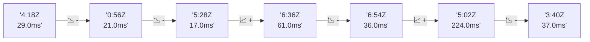

# 📊 Reporte de Performance - PokeAPI

**Fecha de corrida:** 2026-10-30 18:20 UTC

**Enlace:** [41105590297](https://github.com/rba3/Lab_CD_CI_Perfomance/actions/runs/41105590297)

## ✅ Veredicto

```
PASS (fallback por umbrales)

- Error maximo: 0.01%
- p95 maximo: 29.0 ms
```

## 🔮 Predicciones

⚠️ **Tendencia de degradación detectada** (LOW risk)
- Pendiente: +5.0ms/corrida
- P95 actual: 29.0ms
- Días hasta WARN: ~154
- Días hasta FAIL: ~294
- Confianza: 80%

## 📈 Métricas Globales

| Métrica | Valor | SLO | Estado |
|---------|-------|-----|--------|
| Error Rate | 0.01% | < 0.1% | ✅ PASS |
| Latencia p50 | 15.0ms | - | ℹ️ |
| Latencia p95 | 29.0ms | < 800ms | ✅ PASS |
| Latencia p99 | 44.0ms | - | ℹ️ |
| Throughput | 0.00 req/s | - | ℹ️ |
| Muestras | 0 | - | ℹ️ |

## 📉 Tendencia Histórica (Últimas 7 corridas)



## 🔧 Análisis Técnico Detallado (JSON)

```json
{
  "predictions": {
    "prediction": "DEGRADATION_TREND",
    "confidence": 80,
    "slope_ms_per_run": 5.0,
    "current_p95": 29.0,
    "days_to_warn": 154,
    "days_to_fail": 294,
    "risk_level": "LOW"
  },
  "recommendations": [],
  "correlations": {},
  "root_cause": {
    "issue": null,
    "root_cause": null,
    "confidence": 0,
    "evidence": []
  },
  "timestamp": "2026-10-30T18:20:33.236478"
}
```

## 📦 Datos Completos (JSON)

```json
{
  "scenario": "load",
  "overall": {
    "samples": 16502,
    "errors": 1,
    "error_pct": 0.01,
    "avg_ms": 20.8,
    "min_ms": 7,
    "max_ms": 60029,
    "p50_ms": 15.0,
    "p90_ms": 25.0,
    "p95_ms": 29.0,
    "p99_ms": 44.0,
    "throughput_rps": 103.92,
    "duration_s": 158.8
  },
  "by_endpoint": {
    "ability-static": {
      "samples": 1650,
      "errors": 0,
      "error_pct": 0.0,
      "avg_ms": 18.6,
      "min_ms": 8,
      "max_ms": 228,
      "p50_ms": 17.0,
      "p90_ms": 27.0,
      "p95_ms": 32.0,
      "p99_ms": 44.5,
      "throughput_rps": 13.94,
      "duration_s": 118.4
    },
    "berry-cheri": {
      "samples": 1650,
      "errors": 1,
      "error_pct": 0.06,
      "avg_ms": 52.3,
      "min_ms": 8,
      "max_ms": 60029,
      "p50_ms": 14.0,
      "p90_ms": 23.0,
      "p95_ms": 28.0,
      "p99_ms": 43.0,
      "throughput_rps": 10.47,
      "duration_s": 157.6
    },
    "generation-1": {
      "samples": 1650,
      "errors": 0,
      "error_pct": 0.0,
      "avg_ms": 16.4,
      "min_ms": 7,
      "max_ms": 170,
      "p50_ms": 15.0,
      "p90_ms": 23.0,
      "p95_ms": 28.0,
      "p99_ms": 43.0,
      "throughput_rps": 13.97,
      "duration_s": 118.1
    },
    "move-tackle": {
      "samples": 1650,
      "errors": 0,
      "error_pct": 0.0,
      "avg_ms": 17.5,
      "min_ms": 9,
      "max_ms": 147,
      "p50_ms": 15.0,
      "p90_ms": 25.0,
      "p95_ms": 29.0,
      "p99_ms": 44.5,
      "throughput_rps": 13.97,
      "duration_s": 118.2
    },
    "pokemon-charizard": {
      "samples": 1650,
      "errors": 0,
      "error_pct": 0.0,
      "avg_ms": 18.9,
      "min_ms": 8,
      "max_ms": 165,
      "p50_ms": 17.0,
      "p90_ms": 26.0,
      "p95_ms": 32.5,
      "p99_ms": 44.5,
      "throughput_rps": 13.87,
      "duration_s": 119.0
    },
    "pokemon-ditto": {
      "samples": 1651,
      "errors": 0,
      "error_pct": 0.0,
      "avg_ms": 16.2,
      "min_ms": 8,
      "max_ms": 274,
      "p50_ms": 14.0,
      "p90_ms": 23.0,
      "p95_ms": 28.0,
      "p99_ms": 40.5,
      "throughput_rps": 13.8,
      "duration_s": 119.6
    },
    "pokemon-list": {
      "samples": 1650,
      "errors": 0,
      "error_pct": 0.0,
      "avg_ms": 15.8,
      "min_ms": 8,
      "max_ms": 254,
      "p50_ms": 14.0,
      "p90_ms": 23.0,
      "p95_ms": 27.0,
      "p99_ms": 40.5,
      "throughput_rps": 13.9,
      "duration_s": 118.7
    },
    "pokemon-pikachu": {
      "samples": 1651,
      "errors": 0,
      "error_pct": 0.0,
      "avg_ms": 18.8,
      "min_ms": 9,
      "max_ms": 65,
      "p50_ms": 17.0,
      "p90_ms": 27.0,
      "p95_ms": 31.0,
      "p99_ms": 45.5,
      "throughput_rps": 13.86,
      "duration_s": 119.1
    },
    "type-fire": {
      "samples": 1650,
      "errors": 0,
      "error_pct": 0.0,
      "avg_ms": 16.3,
      "min_ms": 8,
      "max_ms": 160,
      "p50_ms": 14.0,
      "p90_ms": 24.0,
      "p95_ms": 29.0,
      "p99_ms": 46.0,
      "throughput_rps": 13.93,
      "duration_s": 118.5
    },
    "type-water": {
      "samples": 1650,
      "errors": 0,
      "error_pct": 0.0,
      "avg_ms": 17.6,
      "min_ms": 9,
      "max_ms": 2136,
      "p50_ms": 15.0,
      "p90_ms": 24.0,
      "p95_ms": 28.0,
      "p99_ms": 42.0,
      "throughput_rps": 13.9,
      "duration_s": 118.7
    }
  },
  "empty": false
}
```

---

*Reporte generado automáticamente por el workflow de performance.*

*Timestamp: 2026-10-30T18:20:33.237899Z*
