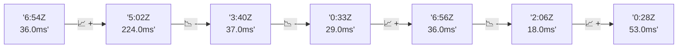

# 📊 Reporte de Performance - PokeAPI

**Fecha de corrida:** 2026-11-03 19:54 UTC

**Enlace:** [41707165191](https://github.com/rba3/Lab_CD_CI_Perfomance/actions/runs/41707165191)

## ✅ Veredicto

```
PASS (fallback por umbrales)

- Error maximo: 0.0%
- p95 maximo: 47.2 ms
```

## 🔮 Predicciones

⚠️ **Tendencia de degradación detectada** (LOW risk)
- Pendiente: +4.0ms/corrida
- P95 actual: 44.0ms
- Días hasta WARN: ~189
- Días hasta FAIL: ~364
- Confianza: 80%

## 📈 Métricas Globales

| Métrica | Valor | SLO | Estado |
|---------|-------|-----|--------|
| Error Rate | 0.0% | < 0.1% | ✅ PASS |
| Latencia p50 | 29.0ms | - | ℹ️ |
| Latencia p95 | 44.0ms | < 800ms | ✅ PASS |
| Latencia p99 | 73.0ms | - | ℹ️ |
| Throughput | 0.00 req/s | - | ℹ️ |
| Muestras | 0 | - | ℹ️ |

## 📉 Tendencia Histórica (Últimas 7 corridas)



## 🔧 Análisis Técnico Detallado (JSON)

```json
{
  "predictions": {
    "prediction": "DEGRADATION_TREND",
    "confidence": 80,
    "slope_ms_per_run": 4.0,
    "current_p95": 44.0,
    "days_to_warn": 189,
    "days_to_fail": 364,
    "risk_level": "LOW"
  },
  "recommendations": [],
  "correlations": {},
  "root_cause": {
    "issue": null,
    "root_cause": null,
    "confidence": 0,
    "evidence": []
  },
  "timestamp": "2026-11-03T19:54:27.824361"
}
```

## 📦 Datos Completos (JSON)

```json
{
  "scenario": "load",
  "overall": {
    "samples": 15891,
    "errors": 0,
    "error_pct": 0.0,
    "avg_ms": 30.8,
    "min_ms": 11,
    "max_ms": 594,
    "p50_ms": 29.0,
    "p90_ms": 39.0,
    "p95_ms": 44.0,
    "p99_ms": 73.0,
    "throughput_rps": 132.82,
    "duration_s": 119.6
  },
  "by_endpoint": {
    "ability-static": {
      "samples": 1589,
      "errors": 0,
      "error_pct": 0.0,
      "avg_ms": 30.1,
      "min_ms": 12,
      "max_ms": 275,
      "p50_ms": 29.0,
      "p90_ms": 37.0,
      "p95_ms": 41.6,
      "p99_ms": 61.4,
      "throughput_rps": 13.42,
      "duration_s": 118.4
    },
    "berry-cheri": {
      "samples": 1589,
      "errors": 0,
      "error_pct": 0.0,
      "avg_ms": 27.7,
      "min_ms": 13,
      "max_ms": 383,
      "p50_ms": 26.0,
      "p90_ms": 34.0,
      "p95_ms": 37.0,
      "p99_ms": 57.2,
      "throughput_rps": 13.45,
      "duration_s": 118.1
    },
    "generation-1": {
      "samples": 1589,
      "errors": 0,
      "error_pct": 0.0,
      "avg_ms": 29.1,
      "min_ms": 13,
      "max_ms": 507,
      "p50_ms": 27.0,
      "p90_ms": 35.0,
      "p95_ms": 40.6,
      "p99_ms": 76.0,
      "throughput_rps": 13.46,
      "duration_s": 118.1
    },
    "move-tackle": {
      "samples": 1589,
      "errors": 0,
      "error_pct": 0.0,
      "avg_ms": 31.3,
      "min_ms": 13,
      "max_ms": 555,
      "p50_ms": 29.0,
      "p90_ms": 38.0,
      "p95_ms": 44.0,
      "p99_ms": 71.1,
      "throughput_rps": 13.45,
      "duration_s": 118.1
    },
    "pokemon-charizard": {
      "samples": 1589,
      "errors": 0,
      "error_pct": 0.0,
      "avg_ms": 36.2,
      "min_ms": 16,
      "max_ms": 594,
      "p50_ms": 34.0,
      "p90_ms": 43.0,
      "p95_ms": 51.6,
      "p99_ms": 106.0,
      "throughput_rps": 13.37,
      "duration_s": 118.8
    },
    "pokemon-ditto": {
      "samples": 1590,
      "errors": 0,
      "error_pct": 0.0,
      "avg_ms": 29.2,
      "min_ms": 13,
      "max_ms": 460,
      "p50_ms": 27.0,
      "p90_ms": 36.0,
      "p95_ms": 41.0,
      "p99_ms": 68.0,
      "throughput_rps": 13.29,
      "duration_s": 119.6
    },
    "pokemon-list": {
      "samples": 1589,
      "errors": 0,
      "error_pct": 0.0,
      "avg_ms": 27.5,
      "min_ms": 11,
      "max_ms": 261,
      "p50_ms": 26.0,
      "p90_ms": 34.0,
      "p95_ms": 39.0,
      "p99_ms": 70.1,
      "throughput_rps": 13.39,
      "duration_s": 118.7
    },
    "pokemon-pikachu": {
      "samples": 1589,
      "errors": 0,
      "error_pct": 0.0,
      "avg_ms": 35.1,
      "min_ms": 14,
      "max_ms": 461,
      "p50_ms": 33.0,
      "p90_ms": 45.0,
      "p95_ms": 53.0,
      "p99_ms": 95.4,
      "throughput_rps": 13.34,
      "duration_s": 119.1
    },
    "type-fire": {
      "samples": 1589,
      "errors": 0,
      "error_pct": 0.0,
      "avg_ms": 32.6,
      "min_ms": 13,
      "max_ms": 361,
      "p50_ms": 31.0,
      "p90_ms": 42.0,
      "p95_ms": 47.0,
      "p99_ms": 68.1,
      "throughput_rps": 13.42,
      "duration_s": 118.4
    },
    "type-water": {
      "samples": 1589,
      "errors": 0,
      "error_pct": 0.0,
      "avg_ms": 28.8,
      "min_ms": 13,
      "max_ms": 188,
      "p50_ms": 27.0,
      "p90_ms": 35.0,
      "p95_ms": 40.0,
      "p99_ms": 72.4,
      "throughput_rps": 13.41,
      "duration_s": 118.5
    }
  },
  "empty": false
}
```

---

*Reporte generado automáticamente por el workflow de performance.*

*Timestamp: 2026-11-03T19:54:27.825860Z*
