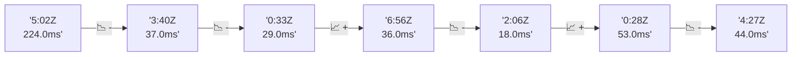

# 📊 Reporte de Performance - PokeAPI

**Fecha de corrida:** 2026-11-04 20:08 UTC

**Enlace:** [41903304716](https://github.com/rba3/Lab_CD_CI_Perfomance/actions/runs/41903304716)

## ✅ Veredicto

```
PASS (fallback por umbrales)

- Error maximo: 0.0%
- p95 maximo: 172.1 ms
```

## 🔮 Predicciones

⚠️ **Tendencia de degradación detectada** (LOW risk)
- Pendiente: +3.75ms/corrida
- P95 actual: 164.0ms
- Días hasta WARN: ~169
- Días hasta FAIL: ~356
- Confianza: 80%

## 📈 Métricas Globales

| Métrica | Valor | SLO | Estado |
|---------|-------|-----|--------|
| Error Rate | 0.0% | < 0.1% | ✅ PASS |
| Latencia p50 | 75.0ms | - | ℹ️ |
| Latencia p95 | 164.0ms | < 800ms | ✅ PASS |
| Latencia p99 | 196.0ms | - | ℹ️ |
| Throughput | 0.00 req/s | - | ℹ️ |
| Muestras | 0 | - | ℹ️ |

## 📉 Tendencia Histórica (Últimas 7 corridas)



## 🔧 Análisis Técnico Detallado (JSON)

```json
{
  "predictions": {
    "prediction": "DEGRADATION_TREND",
    "confidence": 80,
    "slope_ms_per_run": 3.75,
    "current_p95": 164.0,
    "days_to_warn": 169,
    "days_to_fail": 356,
    "risk_level": "LOW"
  },
  "recommendations": [],
  "correlations": {},
  "root_cause": {
    "issue": null,
    "root_cause": null,
    "confidence": 0,
    "evidence": []
  },
  "timestamp": "2026-11-04T20:08:43.913089"
}
```

## 📦 Datos Completos (JSON)

```json
{
  "scenario": "load",
  "overall": {
    "samples": 13813,
    "errors": 0,
    "error_pct": 0.0,
    "avg_ms": 80.6,
    "min_ms": 7,
    "max_ms": 696,
    "p50_ms": 75.0,
    "p90_ms": 125.0,
    "p95_ms": 164.0,
    "p99_ms": 196.0,
    "throughput_rps": 115.38,
    "duration_s": 119.7
  },
  "by_endpoint": {
    "ability-static": {
      "samples": 1382,
      "errors": 0,
      "error_pct": 0.0,
      "avg_ms": 74.4,
      "min_ms": 9,
      "max_ms": 366,
      "p50_ms": 75.0,
      "p90_ms": 120.0,
      "p95_ms": 123.0,
      "p99_ms": 134.0,
      "throughput_rps": 11.69,
      "duration_s": 118.2
    },
    "berry-cheri": {
      "samples": 1381,
      "errors": 0,
      "error_pct": 0.0,
      "avg_ms": 70.9,
      "min_ms": 9,
      "max_ms": 344,
      "p50_ms": 72.0,
      "p90_ms": 115.0,
      "p95_ms": 118.0,
      "p99_ms": 123.2,
      "throughput_rps": 11.7,
      "duration_s": 118.1
    },
    "generation-1": {
      "samples": 1381,
      "errors": 0,
      "error_pct": 0.0,
      "avg_ms": 73.5,
      "min_ms": 10,
      "max_ms": 346,
      "p50_ms": 75.0,
      "p90_ms": 120.0,
      "p95_ms": 122.0,
      "p99_ms": 130.2,
      "throughput_rps": 11.72,
      "duration_s": 117.9
    },
    "move-tackle": {
      "samples": 1381,
      "errors": 0,
      "error_pct": 0.0,
      "avg_ms": 74.8,
      "min_ms": 10,
      "max_ms": 356,
      "p50_ms": 76.0,
      "p90_ms": 125.0,
      "p95_ms": 127.0,
      "p99_ms": 143.2,
      "throughput_rps": 11.71,
      "duration_s": 117.9
    },
    "pokemon-charizard": {
      "samples": 1382,
      "errors": 0,
      "error_pct": 0.0,
      "avg_ms": 112.6,
      "min_ms": 12,
      "max_ms": 696,
      "p50_ms": 106.0,
      "p90_ms": 177.0,
      "p95_ms": 184.0,
      "p99_ms": 374.1,
      "throughput_rps": 11.61,
      "duration_s": 119.1
    },
    "pokemon-ditto": {
      "samples": 1381,
      "errors": 0,
      "error_pct": 0.0,
      "avg_ms": 73.9,
      "min_ms": 8,
      "max_ms": 372,
      "p50_ms": 74.0,
      "p90_ms": 123.0,
      "p95_ms": 126.0,
      "p99_ms": 137.0,
      "throughput_rps": 11.56,
      "duration_s": 119.5
    },
    "pokemon-list": {
      "samples": 1381,
      "errors": 0,
      "error_pct": 0.0,
      "avg_ms": 73.9,
      "min_ms": 7,
      "max_ms": 347,
      "p50_ms": 72.0,
      "p90_ms": 117.0,
      "p95_ms": 119.0,
      "p99_ms": 124.4,
      "throughput_rps": 11.66,
      "duration_s": 118.5
    },
    "pokemon-pikachu": {
      "samples": 1381,
      "errors": 0,
      "error_pct": 0.0,
      "avg_ms": 102.0,
      "min_ms": 12,
      "max_ms": 659,
      "p50_ms": 100.0,
      "p90_ms": 167.0,
      "p95_ms": 173.0,
      "p99_ms": 323.2,
      "throughput_rps": 11.6,
      "duration_s": 119.1
    },
    "type-fire": {
      "samples": 1382,
      "errors": 0,
      "error_pct": 0.0,
      "avg_ms": 73.1,
      "min_ms": 10,
      "max_ms": 355,
      "p50_ms": 74.0,
      "p90_ms": 120.0,
      "p95_ms": 122.0,
      "p99_ms": 128.0,
      "throughput_rps": 11.67,
      "duration_s": 118.4
    },
    "type-water": {
      "samples": 1381,
      "errors": 0,
      "error_pct": 0.0,
      "avg_ms": 76.6,
      "min_ms": 10,
      "max_ms": 350,
      "p50_ms": 75.0,
      "p90_ms": 121.0,
      "p95_ms": 123.0,
      "p99_ms": 129.2,
      "throughput_rps": 11.66,
      "duration_s": 118.5
    }
  },
  "empty": false
}
```

---

*Reporte generado automáticamente por el workflow de performance.*

*Timestamp: 2026-11-04T20:08:43.914575Z*
