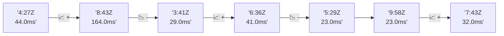

# 📊 Reporte de Performance - PokeAPI

**Fecha de corrida:** 2026-11-10 20:06 UTC

**Enlace:** [42891406772](https://github.com/rba3/Lab_CD_CI_Perfomance/actions/runs/42891406772)

## ✅ Veredicto

```
PASS (fallback por umbrales)

- Error maximo: 0.02%
- p95 maximo: 74.0 ms
```

## 🔮 Predicciones

⚠️ **Tendencia de degradación detectada** (LOW risk)
- Pendiente: +0.75ms/corrida
- P95 actual: 74.0ms
- Días hasta WARN: ~968
- Días hasta FAIL: ~1901
- Confianza: 80%

## 📈 Métricas Globales

| Métrica | Valor | SLO | Estado |
|---------|-------|-----|--------|
| Error Rate | 0.02% | < 0.1% | ✅ PASS |
| Latencia p50 | 26.0ms | - | ℹ️ |
| Latencia p95 | 74.0ms | < 800ms | ✅ PASS |
| Latencia p99 | 98.6ms | - | ℹ️ |
| Throughput | 0.00 req/s | - | ℹ️ |
| Muestras | 0 | - | ℹ️ |

## 📉 Tendencia Histórica (Últimas 7 corridas)



## 🔧 Análisis Técnico Detallado (JSON)

```json
{
  "predictions": {
    "prediction": "DEGRADATION_TREND",
    "confidence": 80,
    "slope_ms_per_run": 0.75,
    "current_p95": 74.0,
    "days_to_warn": 968,
    "days_to_fail": 1901,
    "risk_level": "LOW"
  },
  "recommendations": [],
  "correlations": {},
  "root_cause": {
    "issue": null,
    "root_cause": null,
    "confidence": 0,
    "evidence": []
  },
  "timestamp": "2026-11-10T20:06:03.542238"
}
```

## 📦 Datos Completos (JSON)

```json
{
  "scenario": "load",
  "overall": {
    "samples": 15736,
    "errors": 3,
    "error_pct": 0.02,
    "avg_ms": 34.0,
    "min_ms": 14,
    "max_ms": 499,
    "p50_ms": 26.0,
    "p90_ms": 60.5,
    "p95_ms": 74.0,
    "p99_ms": 98.6,
    "throughput_rps": 131.52,
    "duration_s": 119.6
  },
  "by_endpoint": {
    "ability-static": {
      "samples": 1573,
      "errors": 0,
      "error_pct": 0.0,
      "avg_ms": 35.7,
      "min_ms": 14,
      "max_ms": 227,
      "p50_ms": 28.0,
      "p90_ms": 61.0,
      "p95_ms": 69.8,
      "p99_ms": 137.7,
      "throughput_rps": 13.29,
      "duration_s": 118.3
    },
    "berry-cheri": {
      "samples": 1573,
      "errors": 0,
      "error_pct": 0.0,
      "avg_ms": 31.0,
      "min_ms": 14,
      "max_ms": 282,
      "p50_ms": 25.0,
      "p90_ms": 56.0,
      "p95_ms": 60.0,
      "p99_ms": 81.0,
      "throughput_rps": 13.3,
      "duration_s": 118.3
    },
    "generation-1": {
      "samples": 1574,
      "errors": 1,
      "error_pct": 0.06,
      "avg_ms": 32.1,
      "min_ms": 14,
      "max_ms": 230,
      "p50_ms": 23.0,
      "p90_ms": 58.0,
      "p95_ms": 62.0,
      "p99_ms": 82.5,
      "throughput_rps": 13.34,
      "duration_s": 118.0
    },
    "move-tackle": {
      "samples": 1573,
      "errors": 0,
      "error_pct": 0.0,
      "avg_ms": 33.5,
      "min_ms": 14,
      "max_ms": 168,
      "p50_ms": 27.0,
      "p90_ms": 60.0,
      "p95_ms": 65.0,
      "p99_ms": 89.0,
      "throughput_rps": 13.32,
      "duration_s": 118.1
    },
    "pokemon-charizard": {
      "samples": 1574,
      "errors": 0,
      "error_pct": 0.0,
      "avg_ms": 42.3,
      "min_ms": 19,
      "max_ms": 499,
      "p50_ms": 30.0,
      "p90_ms": 82.0,
      "p95_ms": 89.0,
      "p99_ms": 138.7,
      "throughput_rps": 13.21,
      "duration_s": 119.1
    },
    "pokemon-ditto": {
      "samples": 1574,
      "errors": 1,
      "error_pct": 0.06,
      "avg_ms": 31.6,
      "min_ms": 14,
      "max_ms": 255,
      "p50_ms": 22.0,
      "p90_ms": 59.7,
      "p95_ms": 65.0,
      "p99_ms": 93.0,
      "throughput_rps": 13.16,
      "duration_s": 119.6
    },
    "pokemon-list": {
      "samples": 1574,
      "errors": 0,
      "error_pct": 0.0,
      "avg_ms": 30.5,
      "min_ms": 14,
      "max_ms": 138,
      "p50_ms": 24.0,
      "p90_ms": 56.0,
      "p95_ms": 61.0,
      "p99_ms": 80.3,
      "throughput_rps": 13.26,
      "duration_s": 118.7
    },
    "pokemon-pikachu": {
      "samples": 1574,
      "errors": 0,
      "error_pct": 0.0,
      "avg_ms": 39.7,
      "min_ms": 18,
      "max_ms": 322,
      "p50_ms": 27.0,
      "p90_ms": 77.0,
      "p95_ms": 82.3,
      "p99_ms": 120.8,
      "throughput_rps": 13.22,
      "duration_s": 119.1
    },
    "type-fire": {
      "samples": 1573,
      "errors": 0,
      "error_pct": 0.0,
      "avg_ms": 31.3,
      "min_ms": 14,
      "max_ms": 439,
      "p50_ms": 25.0,
      "p90_ms": 57.0,
      "p95_ms": 62.0,
      "p99_ms": 87.3,
      "throughput_rps": 13.28,
      "duration_s": 118.4
    },
    "type-water": {
      "samples": 1574,
      "errors": 1,
      "error_pct": 0.06,
      "avg_ms": 31.8,
      "min_ms": 14,
      "max_ms": 220,
      "p50_ms": 27.0,
      "p90_ms": 57.0,
      "p95_ms": 62.0,
      "p99_ms": 80.0,
      "throughput_rps": 13.27,
      "duration_s": 118.6
    }
  },
  "empty": false
}
```

---

*Reporte generado automáticamente por el workflow de performance.*

*Timestamp: 2026-11-10T20:06:03.543353Z*
