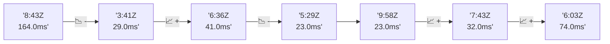

# 📊 Reporte de Performance - PokeAPI

**Fecha de corrida:** 2026-11-11 19:56 UTC

**Enlace:** [43091449014](https://github.com/rba3/Lab_CD_CI_Perfomance/actions/runs/43091449014)

## ✅ Veredicto

```
PASS (fallback por umbrales)

- Error maximo: 0.0%
- p95 maximo: 58.3 ms
```

## 🔮 Predicciones

⚠️ **Tendencia de degradación detectada** (LOW risk)
- Pendiente: +8.25ms/corrida
- P95 actual: 49.0ms
- Días hasta WARN: ~91
- Días hasta FAIL: ~175
- Confianza: 80%

## 📈 Métricas Globales

| Métrica | Valor | SLO | Estado |
|---------|-------|-----|--------|
| Error Rate | 0.0% | < 0.1% | ✅ PASS |
| Latencia p50 | 17.0ms | - | ℹ️ |
| Latencia p95 | 49.0ms | < 800ms | ✅ PASS |
| Latencia p99 | 65.0ms | - | ℹ️ |
| Throughput | 0.00 req/s | - | ℹ️ |
| Muestras | 0 | - | ℹ️ |

## 📉 Tendencia Histórica (Últimas 7 corridas)



## 🔧 Análisis Técnico Detallado (JSON)

```json
{
  "predictions": {
    "prediction": "DEGRADATION_TREND",
    "confidence": 80,
    "slope_ms_per_run": 8.25,
    "current_p95": 49.0,
    "days_to_warn": 91,
    "days_to_fail": 175,
    "risk_level": "LOW"
  },
  "recommendations": [],
  "correlations": {},
  "root_cause": {
    "issue": null,
    "root_cause": null,
    "confidence": 0,
    "evidence": []
  },
  "timestamp": "2026-11-11T19:56:48.671721"
}
```

## 📦 Datos Completos (JSON)

```json
{
  "scenario": "load",
  "overall": {
    "samples": 16190,
    "errors": 0,
    "error_pct": 0.0,
    "avg_ms": 24.6,
    "min_ms": 9,
    "max_ms": 310,
    "p50_ms": 17.0,
    "p90_ms": 45.0,
    "p95_ms": 49.0,
    "p99_ms": 65.0,
    "throughput_rps": 135.31,
    "duration_s": 119.7
  },
  "by_endpoint": {
    "ability-static": {
      "samples": 1619,
      "errors": 0,
      "error_pct": 0.0,
      "avg_ms": 24.2,
      "min_ms": 10,
      "max_ms": 121,
      "p50_ms": 16.0,
      "p90_ms": 43.0,
      "p95_ms": 47.0,
      "p99_ms": 56.0,
      "throughput_rps": 13.67,
      "duration_s": 118.4
    },
    "berry-cheri": {
      "samples": 1620,
      "errors": 0,
      "error_pct": 0.0,
      "avg_ms": 23.2,
      "min_ms": 9,
      "max_ms": 233,
      "p50_ms": 15.0,
      "p90_ms": 40.0,
      "p95_ms": 44.0,
      "p99_ms": 55.8,
      "throughput_rps": 13.68,
      "duration_s": 118.4
    },
    "generation-1": {
      "samples": 1618,
      "errors": 0,
      "error_pct": 0.0,
      "avg_ms": 23.5,
      "min_ms": 10,
      "max_ms": 125,
      "p50_ms": 16.0,
      "p90_ms": 41.0,
      "p95_ms": 45.0,
      "p99_ms": 53.8,
      "throughput_rps": 13.7,
      "duration_s": 118.1
    },
    "move-tackle": {
      "samples": 1619,
      "errors": 0,
      "error_pct": 0.0,
      "avg_ms": 24.8,
      "min_ms": 10,
      "max_ms": 109,
      "p50_ms": 18.0,
      "p90_ms": 42.0,
      "p95_ms": 47.0,
      "p99_ms": 59.8,
      "throughput_rps": 13.7,
      "duration_s": 118.2
    },
    "pokemon-charizard": {
      "samples": 1619,
      "errors": 0,
      "error_pct": 0.0,
      "avg_ms": 29.3,
      "min_ms": 12,
      "max_ms": 310,
      "p50_ms": 19.0,
      "p90_ms": 53.0,
      "p95_ms": 60.0,
      "p99_ms": 89.6,
      "throughput_rps": 13.6,
      "duration_s": 119.0
    },
    "pokemon-ditto": {
      "samples": 1619,
      "errors": 0,
      "error_pct": 0.0,
      "avg_ms": 23.2,
      "min_ms": 9,
      "max_ms": 187,
      "p50_ms": 15.0,
      "p90_ms": 41.0,
      "p95_ms": 45.0,
      "p99_ms": 55.8,
      "throughput_rps": 13.54,
      "duration_s": 119.5
    },
    "pokemon-list": {
      "samples": 1619,
      "errors": 0,
      "error_pct": 0.0,
      "avg_ms": 22.7,
      "min_ms": 9,
      "max_ms": 181,
      "p50_ms": 16.0,
      "p90_ms": 40.0,
      "p95_ms": 45.1,
      "p99_ms": 54.8,
      "throughput_rps": 13.63,
      "duration_s": 118.8
    },
    "pokemon-pikachu": {
      "samples": 1619,
      "errors": 0,
      "error_pct": 0.0,
      "avg_ms": 28.6,
      "min_ms": 12,
      "max_ms": 178,
      "p50_ms": 19.0,
      "p90_ms": 52.0,
      "p95_ms": 58.1,
      "p99_ms": 87.8,
      "throughput_rps": 13.6,
      "duration_s": 119.1
    },
    "type-fire": {
      "samples": 1619,
      "errors": 0,
      "error_pct": 0.0,
      "avg_ms": 23.3,
      "min_ms": 10,
      "max_ms": 102,
      "p50_ms": 16.0,
      "p90_ms": 41.0,
      "p95_ms": 45.0,
      "p99_ms": 52.8,
      "throughput_rps": 13.67,
      "duration_s": 118.4
    },
    "type-water": {
      "samples": 1619,
      "errors": 0,
      "error_pct": 0.0,
      "avg_ms": 22.7,
      "min_ms": 9,
      "max_ms": 164,
      "p50_ms": 15.0,
      "p90_ms": 41.0,
      "p95_ms": 45.0,
      "p99_ms": 54.0,
      "throughput_rps": 13.64,
      "duration_s": 118.7
    }
  },
  "empty": false
}
```

---

*Reporte generado automáticamente por el workflow de performance.*

*Timestamp: 2026-11-11T19:56:48.672799Z*
