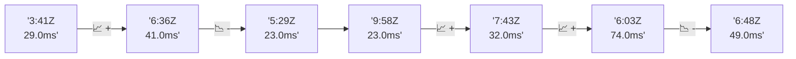

# 📊 Reporte de Performance - PokeAPI

**Fecha de corrida:** 2026-11-12 20:32 UTC

**Enlace:** [43300924916](https://github.com/rba3/Lab_CD_CI_Perfomance/actions/runs/43300924916)

## ✅ Veredicto

```
PASS (fallback por umbrales)

- Error maximo: 0.01%
- p95 maximo: 81.7 ms
```

## 🔮 Predicciones

⚠️ **Tendencia de degradación detectada** (LOW risk)
- Pendiente: +6.5ms/corrida
- P95 actual: 42.0ms
- Días hasta WARN: ~116
- Días hasta FAIL: ~224
- Confianza: 80%

## 📈 Métricas Globales

| Métrica | Valor | SLO | Estado |
|---------|-------|-----|--------|
| Error Rate | 0.01% | < 0.1% | ✅ PASS |
| Latencia p50 | 28.0ms | - | ℹ️ |
| Latencia p95 | 42.0ms | < 800ms | ✅ PASS |
| Latencia p99 | 67.0ms | - | ℹ️ |
| Throughput | 0.00 req/s | - | ℹ️ |
| Muestras | 0 | - | ℹ️ |

## 📉 Tendencia Histórica (Últimas 7 corridas)



## 🔧 Análisis Técnico Detallado (JSON)

```json
{
  "predictions": {
    "prediction": "DEGRADATION_TREND",
    "confidence": 80,
    "slope_ms_per_run": 6.5,
    "current_p95": 42.0,
    "days_to_warn": 116,
    "days_to_fail": 224,
    "risk_level": "LOW"
  },
  "recommendations": [],
  "correlations": {},
  "root_cause": {
    "issue": null,
    "root_cause": null,
    "confidence": 0,
    "evidence": []
  },
  "timestamp": "2026-11-12T20:32:57.605071"
}
```

## 📦 Datos Completos (JSON)

```json
{
  "scenario": "load",
  "overall": {
    "samples": 15915,
    "errors": 1,
    "error_pct": 0.01,
    "avg_ms": 30.3,
    "min_ms": 18,
    "max_ms": 264,
    "p50_ms": 28.0,
    "p90_ms": 37.0,
    "p95_ms": 42.0,
    "p99_ms": 67.0,
    "throughput_rps": 132.97,
    "duration_s": 119.7
  },
  "by_endpoint": {
    "ability-static": {
      "samples": 1591,
      "errors": 1,
      "error_pct": 0.06,
      "avg_ms": 29.1,
      "min_ms": 18,
      "max_ms": 221,
      "p50_ms": 27.0,
      "p90_ms": 35.0,
      "p95_ms": 40.0,
      "p99_ms": 63.0,
      "throughput_rps": 13.44,
      "duration_s": 118.3
    },
    "berry-cheri": {
      "samples": 1591,
      "errors": 0,
      "error_pct": 0.0,
      "avg_ms": 28.4,
      "min_ms": 21,
      "max_ms": 176,
      "p50_ms": 26.0,
      "p90_ms": 35.0,
      "p95_ms": 41.0,
      "p99_ms": 64.0,
      "throughput_rps": 13.45,
      "duration_s": 118.3
    },
    "generation-1": {
      "samples": 1592,
      "errors": 0,
      "error_pct": 0.0,
      "avg_ms": 29.6,
      "min_ms": 22,
      "max_ms": 109,
      "p50_ms": 28.0,
      "p90_ms": 36.0,
      "p95_ms": 41.0,
      "p99_ms": 67.0,
      "throughput_rps": 13.48,
      "duration_s": 118.1
    },
    "move-tackle": {
      "samples": 1591,
      "errors": 0,
      "error_pct": 0.0,
      "avg_ms": 29.9,
      "min_ms": 22,
      "max_ms": 116,
      "p50_ms": 28.0,
      "p90_ms": 36.0,
      "p95_ms": 40.5,
      "p99_ms": 70.1,
      "throughput_rps": 13.47,
      "duration_s": 118.1
    },
    "pokemon-charizard": {
      "samples": 1592,
      "errors": 0,
      "error_pct": 0.0,
      "avg_ms": 37.5,
      "min_ms": 29,
      "max_ms": 230,
      "p50_ms": 35.0,
      "p90_ms": 42.0,
      "p95_ms": 52.0,
      "p99_ms": 84.4,
      "throughput_rps": 13.36,
      "duration_s": 119.1
    },
    "pokemon-ditto": {
      "samples": 1592,
      "errors": 0,
      "error_pct": 0.0,
      "avg_ms": 29.4,
      "min_ms": 21,
      "max_ms": 264,
      "p50_ms": 27.0,
      "p90_ms": 35.0,
      "p95_ms": 41.0,
      "p99_ms": 63.0,
      "throughput_rps": 13.31,
      "duration_s": 119.6
    },
    "pokemon-list": {
      "samples": 1591,
      "errors": 0,
      "error_pct": 0.0,
      "avg_ms": 27.5,
      "min_ms": 22,
      "max_ms": 186,
      "p50_ms": 26.0,
      "p90_ms": 32.0,
      "p95_ms": 37.0,
      "p99_ms": 64.1,
      "throughput_rps": 13.41,
      "duration_s": 118.7
    },
    "pokemon-pikachu": {
      "samples": 1592,
      "errors": 0,
      "error_pct": 0.0,
      "avg_ms": 35.2,
      "min_ms": 26,
      "max_ms": 263,
      "p50_ms": 33.0,
      "p90_ms": 40.0,
      "p95_ms": 49.4,
      "p99_ms": 83.6,
      "throughput_rps": 13.37,
      "duration_s": 119.1
    },
    "type-fire": {
      "samples": 1591,
      "errors": 0,
      "error_pct": 0.0,
      "avg_ms": 28.1,
      "min_ms": 21,
      "max_ms": 123,
      "p50_ms": 27.0,
      "p90_ms": 33.0,
      "p95_ms": 37.0,
      "p99_ms": 55.0,
      "throughput_rps": 13.43,
      "duration_s": 118.4
    },
    "type-water": {
      "samples": 1592,
      "errors": 0,
      "error_pct": 0.0,
      "avg_ms": 27.8,
      "min_ms": 20,
      "max_ms": 110,
      "p50_ms": 26.0,
      "p90_ms": 32.0,
      "p95_ms": 36.0,
      "p99_ms": 59.3,
      "throughput_rps": 13.41,
      "duration_s": 118.7
    }
  },
  "empty": false
}
```

---

*Reporte generado automáticamente por el workflow de performance.*

*Timestamp: 2026-11-12T20:32:57.606179Z*
