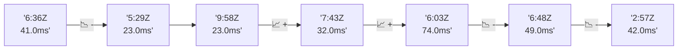

# 📊 Reporte de Performance - PokeAPI

**Fecha de corrida:** 2026-11-13 20:09 UTC

**Enlace:** [43498538605](https://github.com/rba3/Lab_CD_CI_Perfomance/actions/runs/43498538605)

## ✅ Veredicto

```
PASS (fallback por umbrales)

- Error maximo: 0.0%
- p95 maximo: 121.0 ms
```

## 🔮 Predicciones

⚠️ **Tendencia de degradación detectada** (LOW risk)
- Pendiente: +4.75ms/corrida
- P95 actual: 121.0ms
- Días hasta WARN: ~142
- Días hasta FAIL: ~290
- Confianza: 80%

## 🎯 Causa Raíz Identificada

**Latencia inconsistente (outliers)**
- Causa probable: Spikes de latencia, posible GC o context switching
- Confianza: 75%
- Evidencia:
  - p50 (32.0ms) mucho menor que p95 (121.0ms)
  - Diferencia de 3x+ indica distribución anómala

## 📈 Métricas Globales

| Métrica | Valor | SLO | Estado |
|---------|-------|-----|--------|
| Error Rate | 0.0% | < 0.1% | ✅ PASS |
| Latencia p50 | 32.0ms | - | ℹ️ |
| Latencia p95 | 121.0ms | < 800ms | ✅ PASS |
| Latencia p99 | 148.0ms | - | ℹ️ |
| Throughput | 0.00 req/s | - | ℹ️ |
| Muestras | 0 | - | ℹ️ |

## 📉 Tendencia Histórica (Últimas 7 corridas)



## 🔧 Análisis Técnico Detallado (JSON)

```json
{
  "predictions": {
    "prediction": "DEGRADATION_TREND",
    "confidence": 80,
    "slope_ms_per_run": 4.75,
    "current_p95": 121.0,
    "days_to_warn": 142,
    "days_to_fail": 290,
    "risk_level": "LOW"
  },
  "recommendations": [],
  "correlations": {},
  "root_cause": {
    "issue": "Latencia inconsistente (outliers)",
    "root_cause": "Spikes de latencia, posible GC o context switching",
    "confidence": 75,
    "evidence": [
      "p50 (32.0ms) mucho menor que p95 (121.0ms)",
      "Diferencia de 3x+ indica distribuci\u00f3n an\u00f3mala"
    ]
  },
  "timestamp": "2026-11-13T20:09:49.462790"
}
```

## 📦 Datos Completos (JSON)

```json
{
  "scenario": "load",
  "overall": {
    "samples": 15034,
    "errors": 0,
    "error_pct": 0.0,
    "avg_ms": 49.6,
    "min_ms": 19,
    "max_ms": 1426,
    "p50_ms": 32.0,
    "p90_ms": 101.0,
    "p95_ms": 121.0,
    "p99_ms": 148.0,
    "throughput_rps": 125.62,
    "duration_s": 119.7
  },
  "by_endpoint": {
    "ability-static": {
      "samples": 1503,
      "errors": 0,
      "error_pct": 0.0,
      "avg_ms": 49.5,
      "min_ms": 21,
      "max_ms": 1426,
      "p50_ms": 32.0,
      "p90_ms": 97.0,
      "p95_ms": 104.0,
      "p99_ms": 120.0,
      "throughput_rps": 12.72,
      "duration_s": 118.1
    },
    "berry-cheri": {
      "samples": 1503,
      "errors": 0,
      "error_pct": 0.0,
      "avg_ms": 42.6,
      "min_ms": 19,
      "max_ms": 270,
      "p50_ms": 28.0,
      "p90_ms": 92.0,
      "p95_ms": 99.0,
      "p99_ms": 119.0,
      "throughput_rps": 12.75,
      "duration_s": 117.9
    },
    "generation-1": {
      "samples": 1503,
      "errors": 0,
      "error_pct": 0.0,
      "avg_ms": 45.5,
      "min_ms": 20,
      "max_ms": 662,
      "p50_ms": 30.0,
      "p90_ms": 95.0,
      "p95_ms": 103.0,
      "p99_ms": 121.0,
      "throughput_rps": 12.76,
      "duration_s": 117.8
    },
    "move-tackle": {
      "samples": 1503,
      "errors": 0,
      "error_pct": 0.0,
      "avg_ms": 48.3,
      "min_ms": 21,
      "max_ms": 305,
      "p50_ms": 32.0,
      "p90_ms": 99.0,
      "p95_ms": 106.0,
      "p99_ms": 119.0,
      "throughput_rps": 12.75,
      "duration_s": 117.9
    },
    "pokemon-charizard": {
      "samples": 1504,
      "errors": 0,
      "error_pct": 0.0,
      "avg_ms": 63.5,
      "min_ms": 27,
      "max_ms": 522,
      "p50_ms": 38.0,
      "p90_ms": 137.0,
      "p95_ms": 147.0,
      "p99_ms": 228.5,
      "throughput_rps": 12.64,
      "duration_s": 118.9
    },
    "pokemon-ditto": {
      "samples": 1504,
      "errors": 0,
      "error_pct": 0.0,
      "avg_ms": 46.0,
      "min_ms": 21,
      "max_ms": 420,
      "p50_ms": 31.0,
      "p90_ms": 96.7,
      "p95_ms": 103.0,
      "p99_ms": 114.0,
      "throughput_rps": 12.57,
      "duration_s": 119.7
    },
    "pokemon-list": {
      "samples": 1504,
      "errors": 0,
      "error_pct": 0.0,
      "avg_ms": 46.4,
      "min_ms": 19,
      "max_ms": 808,
      "p50_ms": 29.0,
      "p90_ms": 93.0,
      "p95_ms": 100.0,
      "p99_ms": 115.0,
      "throughput_rps": 12.69,
      "duration_s": 118.5
    },
    "pokemon-pikachu": {
      "samples": 1504,
      "errors": 0,
      "error_pct": 0.0,
      "avg_ms": 62.5,
      "min_ms": 26,
      "max_ms": 527,
      "p50_ms": 38.0,
      "p90_ms": 131.0,
      "p95_ms": 139.8,
      "p99_ms": 166.0,
      "throughput_rps": 12.63,
      "duration_s": 119.1
    },
    "type-fire": {
      "samples": 1503,
      "errors": 0,
      "error_pct": 0.0,
      "avg_ms": 45.3,
      "min_ms": 20,
      "max_ms": 275,
      "p50_ms": 30.0,
      "p90_ms": 95.8,
      "p95_ms": 102.0,
      "p99_ms": 115.0,
      "throughput_rps": 12.72,
      "duration_s": 118.2
    },
    "type-water": {
      "samples": 1503,
      "errors": 0,
      "error_pct": 0.0,
      "avg_ms": 46.8,
      "min_ms": 20,
      "max_ms": 302,
      "p50_ms": 30.0,
      "p90_ms": 97.0,
      "p95_ms": 104.0,
      "p99_ms": 117.0,
      "throughput_rps": 12.71,
      "duration_s": 118.2
    }
  },
  "empty": false
}
```

---

*Reporte generado automáticamente por el workflow de performance.*

*Timestamp: 2026-11-13T20:09:49.463712Z*
