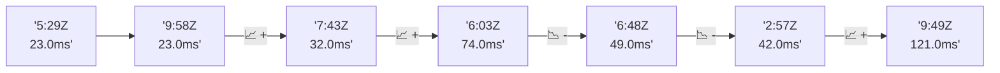

# 📊 Reporte de Performance - PokeAPI

**Fecha de corrida:** 2026-11-14 18:35 UTC

**Enlace:** [43627171854](https://github.com/rba3/Lab_CD_CI_Perfomance/actions/runs/43627171854)

## ✅ Veredicto

```
PASS (fallback por umbrales)

- Error maximo: 0.0%
- p95 maximo: 29.0 ms
```

## 🔮 Predicciones

⚠️ **Tendencia de degradación detectada** (MEDIUM risk)
- Pendiente: +22.25ms/corrida
- P95 actual: 24.0ms
- Días hasta WARN: ~34
- Días hasta FAIL: ~66
- Confianza: 80%

## 📈 Métricas Globales

| Métrica | Valor | SLO | Estado |
|---------|-------|-----|--------|
| Error Rate | 0.0% | < 0.1% | ✅ PASS |
| Latencia p50 | 18.0ms | - | ℹ️ |
| Latencia p95 | 24.0ms | < 800ms | ✅ PASS |
| Latencia p99 | 40.0ms | - | ℹ️ |
| Throughput | 0.00 req/s | - | ℹ️ |
| Muestras | 0 | - | ℹ️ |

## 📉 Tendencia Histórica (Últimas 7 corridas)



## 🔧 Análisis Técnico Detallado (JSON)

```json
{
  "predictions": {
    "prediction": "DEGRADATION_TREND",
    "confidence": 80,
    "slope_ms_per_run": 22.25,
    "current_p95": 24.0,
    "days_to_warn": 34,
    "days_to_fail": 66,
    "risk_level": "MEDIUM"
  },
  "recommendations": [],
  "correlations": {},
  "root_cause": {
    "issue": null,
    "root_cause": null,
    "confidence": 0,
    "evidence": []
  },
  "timestamp": "2026-11-14T18:35:21.129930"
}
```

## 📦 Datos Completos (JSON)

```json
{
  "scenario": "load",
  "overall": {
    "samples": 16473,
    "errors": 0,
    "error_pct": 0.0,
    "avg_ms": 18.9,
    "min_ms": 13,
    "max_ms": 243,
    "p50_ms": 18.0,
    "p90_ms": 22.0,
    "p95_ms": 24.0,
    "p99_ms": 40.0,
    "throughput_rps": 137.72,
    "duration_s": 119.6
  },
  "by_endpoint": {
    "ability-static": {
      "samples": 1647,
      "errors": 0,
      "error_pct": 0.0,
      "avg_ms": 18.1,
      "min_ms": 13,
      "max_ms": 169,
      "p50_ms": 17.0,
      "p90_ms": 20.0,
      "p95_ms": 22.0,
      "p99_ms": 40.5,
      "throughput_rps": 13.92,
      "duration_s": 118.3
    },
    "berry-cheri": {
      "samples": 1647,
      "errors": 0,
      "error_pct": 0.0,
      "avg_ms": 17.4,
      "min_ms": 13,
      "max_ms": 131,
      "p50_ms": 17.0,
      "p90_ms": 20.0,
      "p95_ms": 22.0,
      "p99_ms": 31.0,
      "throughput_rps": 13.92,
      "duration_s": 118.3
    },
    "generation-1": {
      "samples": 1647,
      "errors": 0,
      "error_pct": 0.0,
      "avg_ms": 18.3,
      "min_ms": 13,
      "max_ms": 86,
      "p50_ms": 17.0,
      "p90_ms": 21.0,
      "p95_ms": 23.0,
      "p99_ms": 35.1,
      "throughput_rps": 13.95,
      "duration_s": 118.1
    },
    "move-tackle": {
      "samples": 1647,
      "errors": 0,
      "error_pct": 0.0,
      "avg_ms": 18.6,
      "min_ms": 14,
      "max_ms": 126,
      "p50_ms": 18.0,
      "p90_ms": 21.0,
      "p95_ms": 23.0,
      "p99_ms": 41.0,
      "throughput_rps": 13.95,
      "duration_s": 118.1
    },
    "pokemon-charizard": {
      "samples": 1647,
      "errors": 0,
      "error_pct": 0.0,
      "avg_ms": 22.5,
      "min_ms": 17,
      "max_ms": 174,
      "p50_ms": 21.0,
      "p90_ms": 25.0,
      "p95_ms": 28.7,
      "p99_ms": 41.0,
      "throughput_rps": 13.84,
      "duration_s": 119.0
    },
    "pokemon-ditto": {
      "samples": 1649,
      "errors": 0,
      "error_pct": 0.0,
      "avg_ms": 18.6,
      "min_ms": 14,
      "max_ms": 243,
      "p50_ms": 17.0,
      "p90_ms": 21.0,
      "p95_ms": 23.0,
      "p99_ms": 44.0,
      "throughput_rps": 13.79,
      "duration_s": 119.6
    },
    "pokemon-list": {
      "samples": 1648,
      "errors": 0,
      "error_pct": 0.0,
      "avg_ms": 17.4,
      "min_ms": 13,
      "max_ms": 169,
      "p50_ms": 17.0,
      "p90_ms": 20.0,
      "p95_ms": 21.0,
      "p99_ms": 28.5,
      "throughput_rps": 13.88,
      "duration_s": 118.7
    },
    "pokemon-pikachu": {
      "samples": 1647,
      "errors": 0,
      "error_pct": 0.0,
      "avg_ms": 21.8,
      "min_ms": 17,
      "max_ms": 148,
      "p50_ms": 20.0,
      "p90_ms": 24.4,
      "p95_ms": 28.0,
      "p99_ms": 63.0,
      "throughput_rps": 13.84,
      "duration_s": 119.0
    },
    "type-fire": {
      "samples": 1647,
      "errors": 0,
      "error_pct": 0.0,
      "avg_ms": 17.9,
      "min_ms": 13,
      "max_ms": 168,
      "p50_ms": 17.0,
      "p90_ms": 20.0,
      "p95_ms": 22.0,
      "p99_ms": 37.6,
      "throughput_rps": 13.91,
      "duration_s": 118.4
    },
    "type-water": {
      "samples": 1647,
      "errors": 0,
      "error_pct": 0.0,
      "avg_ms": 17.9,
      "min_ms": 13,
      "max_ms": 116,
      "p50_ms": 17.0,
      "p90_ms": 21.0,
      "p95_ms": 22.0,
      "p99_ms": 31.5,
      "throughput_rps": 13.89,
      "duration_s": 118.6
    }
  },
  "empty": false
}
```

---

*Reporte generado automáticamente por el workflow de performance.*

*Timestamp: 2026-11-14T18:35:21.130817Z*
