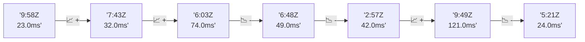

# 📊 Reporte de Performance - PokeAPI

**Fecha de corrida:** 2026-11-15 19:11 UTC

**Enlace:** [43750774639](https://github.com/rba3/Lab_CD_CI_Perfomance/actions/runs/43750774639)

## ✅ Veredicto

```
PASS (fallback por umbrales)

- Error maximo: 0.0%
- p95 maximo: 46.8 ms
```

## 🔮 Predicciones

✓ STABLE

## 📈 Métricas Globales

| Métrica | Valor | SLO | Estado |
|---------|-------|-----|--------|
| Error Rate | 0.0% | < 0.1% | ✅ PASS |
| Latencia p50 | 25.0ms | - | ℹ️ |
| Latencia p95 | 39.0ms | < 800ms | ✅ PASS |
| Latencia p99 | 62.0ms | - | ℹ️ |
| Throughput | 0.00 req/s | - | ℹ️ |
| Muestras | 0 | - | ℹ️ |

## 📉 Tendencia Histórica (Últimas 7 corridas)



## 🔧 Análisis Técnico Detallado (JSON)

```json
{
  "predictions": {
    "prediction": "STABLE",
    "confidence": 0,
    "slope_ms_per_run": -12.5,
    "current_p95": 39.0,
    "days_to_warn": null,
    "days_to_fail": null,
    "risk_level": "LOW"
  },
  "recommendations": [],
  "correlations": {},
  "root_cause": {
    "issue": null,
    "root_cause": null,
    "confidence": 0,
    "evidence": []
  },
  "timestamp": "2026-11-15T19:11:43.265422"
}
```

## 📦 Datos Completos (JSON)

```json
{
  "scenario": "load",
  "overall": {
    "samples": 16176,
    "errors": 0,
    "error_pct": 0.0,
    "avg_ms": 24.9,
    "min_ms": 8,
    "max_ms": 290,
    "p50_ms": 25.0,
    "p90_ms": 36.0,
    "p95_ms": 39.0,
    "p99_ms": 62.0,
    "throughput_rps": 135.21,
    "duration_s": 119.6
  },
  "by_endpoint": {
    "ability-static": {
      "samples": 1618,
      "errors": 0,
      "error_pct": 0.0,
      "avg_ms": 24.0,
      "min_ms": 8,
      "max_ms": 88,
      "p50_ms": 25.0,
      "p90_ms": 32.0,
      "p95_ms": 36.0,
      "p99_ms": 40.8,
      "throughput_rps": 13.67,
      "duration_s": 118.3
    },
    "berry-cheri": {
      "samples": 1617,
      "errors": 0,
      "error_pct": 0.0,
      "avg_ms": 23.8,
      "min_ms": 9,
      "max_ms": 197,
      "p50_ms": 25.0,
      "p90_ms": 34.0,
      "p95_ms": 35.0,
      "p99_ms": 41.8,
      "throughput_rps": 13.67,
      "duration_s": 118.3
    },
    "generation-1": {
      "samples": 1618,
      "errors": 0,
      "error_pct": 0.0,
      "avg_ms": 24.3,
      "min_ms": 9,
      "max_ms": 276,
      "p50_ms": 25.0,
      "p90_ms": 35.0,
      "p95_ms": 37.0,
      "p99_ms": 45.0,
      "throughput_rps": 13.71,
      "duration_s": 118.0
    },
    "move-tackle": {
      "samples": 1617,
      "errors": 0,
      "error_pct": 0.0,
      "avg_ms": 25.6,
      "min_ms": 9,
      "max_ms": 288,
      "p50_ms": 27.0,
      "p90_ms": 37.0,
      "p95_ms": 39.0,
      "p99_ms": 68.3,
      "throughput_rps": 13.69,
      "duration_s": 118.1
    },
    "pokemon-charizard": {
      "samples": 1618,
      "errors": 0,
      "error_pct": 0.0,
      "avg_ms": 28.6,
      "min_ms": 10,
      "max_ms": 203,
      "p50_ms": 33.0,
      "p90_ms": 45.0,
      "p95_ms": 51.0,
      "p99_ms": 74.0,
      "throughput_rps": 13.59,
      "duration_s": 119.0
    },
    "pokemon-ditto": {
      "samples": 1618,
      "errors": 0,
      "error_pct": 0.0,
      "avg_ms": 24.1,
      "min_ms": 9,
      "max_ms": 290,
      "p50_ms": 26.0,
      "p90_ms": 37.0,
      "p95_ms": 39.0,
      "p99_ms": 45.0,
      "throughput_rps": 13.53,
      "duration_s": 119.6
    },
    "pokemon-list": {
      "samples": 1618,
      "errors": 0,
      "error_pct": 0.0,
      "avg_ms": 22.1,
      "min_ms": 8,
      "max_ms": 174,
      "p50_ms": 24.0,
      "p90_ms": 31.0,
      "p95_ms": 35.0,
      "p99_ms": 45.0,
      "throughput_rps": 13.64,
      "duration_s": 118.6
    },
    "pokemon-pikachu": {
      "samples": 1618,
      "errors": 0,
      "error_pct": 0.0,
      "avg_ms": 28.3,
      "min_ms": 10,
      "max_ms": 197,
      "p50_ms": 31.0,
      "p90_ms": 47.0,
      "p95_ms": 51.0,
      "p99_ms": 88.1,
      "throughput_rps": 13.59,
      "duration_s": 119.1
    },
    "type-fire": {
      "samples": 1617,
      "errors": 0,
      "error_pct": 0.0,
      "avg_ms": 24.5,
      "min_ms": 9,
      "max_ms": 258,
      "p50_ms": 26.0,
      "p90_ms": 34.0,
      "p95_ms": 37.0,
      "p99_ms": 51.2,
      "throughput_rps": 13.65,
      "duration_s": 118.5
    },
    "type-water": {
      "samples": 1617,
      "errors": 0,
      "error_pct": 0.0,
      "avg_ms": 23.5,
      "min_ms": 8,
      "max_ms": 203,
      "p50_ms": 25.0,
      "p90_ms": 31.0,
      "p95_ms": 36.0,
      "p99_ms": 42.0,
      "throughput_rps": 13.64,
      "duration_s": 118.6
    }
  },
  "empty": false
}
```

---

*Reporte generado automáticamente por el workflow de performance.*

*Timestamp: 2026-11-15T19:11:43.266221Z*
