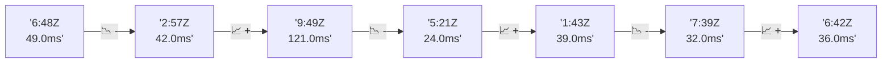

# 📊 Reporte de Performance - PokeAPI

**Fecha de corrida:** 2026-11-18 20:59 UTC

**Enlace:** [44396210107](https://github.com/rba3/Lab_CD_CI_Perfomance/actions/runs/44396210107)

## ✅ Veredicto

```
WARN (fallback por umbrales)

- Error maximo: 0.38%
- p95 maximo: 260.0 ms
```

## 🔮 Predicciones

✓ STABLE

## 📈 Métricas Globales

| Métrica | Valor | SLO | Estado |
|---------|-------|-----|--------|
| Error Rate | 0.38% | < 0.1% | ⚠️ WARN |
| Latencia p50 | 166.0ms | - | ℹ️ |
| Latencia p95 | 251.0ms | < 800ms | ✅ PASS |
| Latencia p99 | 511.0ms | - | ℹ️ |
| Throughput | 0.00 req/s | - | ℹ️ |
| Muestras | 0 | - | ℹ️ |

## 📉 Tendencia Histórica (Últimas 7 corridas)



## 🔧 Análisis Técnico Detallado (JSON)

```json
{
  "predictions": {
    "prediction": "STABLE",
    "confidence": 0,
    "slope_ms_per_run": -21.25,
    "current_p95": 251.0,
    "days_to_warn": null,
    "days_to_fail": null,
    "risk_level": "LOW"
  },
  "recommendations": [],
  "correlations": {},
  "root_cause": {
    "issue": null,
    "root_cause": null,
    "confidence": 0,
    "evidence": []
  },
  "timestamp": "2026-11-18T20:59:06.734110"
}
```

## 📦 Datos Completos (JSON)

```json
{
  "scenario": "load",
  "overall": {
    "samples": 10791,
    "errors": 41,
    "error_pct": 0.38,
    "avg_ms": 187.5,
    "min_ms": 0,
    "max_ms": 951,
    "p50_ms": 166.0,
    "p90_ms": 236.0,
    "p95_ms": 251.0,
    "p99_ms": 511.0,
    "throughput_rps": 90.01,
    "duration_s": 119.9
  },
  "by_endpoint": {
    "ability-static": {
      "samples": 1079,
      "errors": 3,
      "error_pct": 0.28,
      "avg_ms": 169.6,
      "min_ms": 0,
      "max_ms": 517,
      "p50_ms": 164.0,
      "p90_ms": 176.0,
      "p95_ms": 186.0,
      "p99_ms": 476.2,
      "throughput_rps": 9.16,
      "duration_s": 117.8
    },
    "berry-cheri": {
      "samples": 1079,
      "errors": 5,
      "error_pct": 0.46,
      "avg_ms": 162.5,
      "min_ms": 1,
      "max_ms": 530,
      "p50_ms": 157.0,
      "p90_ms": 166.0,
      "p95_ms": 176.0,
      "p99_ms": 450.1,
      "throughput_rps": 9.16,
      "duration_s": 117.8
    },
    "generation-1": {
      "samples": 1078,
      "errors": 3,
      "error_pct": 0.28,
      "avg_ms": 168.6,
      "min_ms": 1,
      "max_ms": 532,
      "p50_ms": 162.0,
      "p90_ms": 175.0,
      "p95_ms": 181.1,
      "p99_ms": 469.2,
      "throughput_rps": 9.19,
      "duration_s": 117.4
    },
    "move-tackle": {
      "samples": 1079,
      "errors": 5,
      "error_pct": 0.46,
      "avg_ms": 183.1,
      "min_ms": 1,
      "max_ms": 708,
      "p50_ms": 173.0,
      "p90_ms": 190.0,
      "p95_ms": 210.1,
      "p99_ms": 613.0,
      "throughput_rps": 9.18,
      "duration_s": 117.5
    },
    "pokemon-charizard": {
      "samples": 1080,
      "errors": 4,
      "error_pct": 0.37,
      "avg_ms": 263.0,
      "min_ms": 0,
      "max_ms": 951,
      "p50_ms": 238.0,
      "p90_ms": 282.0,
      "p95_ms": 474.7,
      "p99_ms": 639.3,
      "throughput_rps": 9.09,
      "duration_s": 118.9
    },
    "pokemon-ditto": {
      "samples": 1079,
      "errors": 5,
      "error_pct": 0.46,
      "avg_ms": 171.2,
      "min_ms": 1,
      "max_ms": 730,
      "p50_ms": 166.0,
      "p90_ms": 183.0,
      "p95_ms": 191.0,
      "p99_ms": 223.5,
      "throughput_rps": 9.01,
      "duration_s": 119.7
    },
    "pokemon-list": {
      "samples": 1079,
      "errors": 6,
      "error_pct": 0.56,
      "avg_ms": 163.1,
      "min_ms": 1,
      "max_ms": 508,
      "p50_ms": 158.0,
      "p90_ms": 166.0,
      "p95_ms": 172.1,
      "p99_ms": 459.2,
      "throughput_rps": 9.1,
      "duration_s": 118.6
    },
    "pokemon-pikachu": {
      "samples": 1080,
      "errors": 4,
      "error_pct": 0.37,
      "avg_ms": 250.9,
      "min_ms": 1,
      "max_ms": 943,
      "p50_ms": 224.0,
      "p90_ms": 268.1,
      "p95_ms": 460.5,
      "p99_ms": 882.4,
      "throughput_rps": 9.05,
      "duration_s": 119.3
    },
    "type-fire": {
      "samples": 1079,
      "errors": 5,
      "error_pct": 0.46,
      "avg_ms": 170.5,
      "min_ms": 0,
      "max_ms": 541,
      "p50_ms": 163.0,
      "p90_ms": 176.0,
      "p95_ms": 185.0,
      "p99_ms": 468.0,
      "throughput_rps": 9.15,
      "duration_s": 118.0
    },
    "type-water": {
      "samples": 1079,
      "errors": 1,
      "error_pct": 0.09,
      "avg_ms": 172.6,
      "min_ms": 150,
      "max_ms": 517,
      "p50_ms": 163.0,
      "p90_ms": 178.2,
      "p95_ms": 187.0,
      "p99_ms": 480.0,
      "throughput_rps": 9.14,
      "duration_s": 118.0
    }
  },
  "empty": false
}
```

---

*Reporte generado automáticamente por el workflow de performance.*

*Timestamp: 2026-11-18T20:59:06.734784Z*
