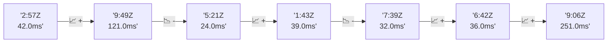

# 📊 Reporte de Performance - PokeAPI

**Fecha de corrida:** 2026-11-19 21:04 UTC

**Enlace:** [44614601573](https://github.com/rba3/Lab_CD_CI_Perfomance/actions/runs/44614601573)

## ✅ Veredicto

```
PASS (fallback por umbrales)

- Error maximo: 0.01%
- p95 maximo: 55.7 ms
```

## 🔮 Predicciones

⚠️ **Tendencia de degradación detectada** (HIGH risk)
- Pendiente: +56.75ms/corrida
- P95 actual: 46.0ms
- Días hasta WARN: ~13
- Días hasta FAIL: ~25
- Confianza: 80%

## 📈 Métricas Globales

| Métrica | Valor | SLO | Estado |
|---------|-------|-----|--------|
| Error Rate | 0.01% | < 0.1% | ✅ PASS |
| Latencia p50 | 31.0ms | - | ℹ️ |
| Latencia p95 | 46.0ms | < 800ms | ✅ PASS |
| Latencia p99 | 72.9ms | - | ℹ️ |
| Throughput | 0.00 req/s | - | ℹ️ |
| Muestras | 0 | - | ℹ️ |

## 📉 Tendencia Histórica (Últimas 7 corridas)



## 🔧 Análisis Técnico Detallado (JSON)

```json
{
  "predictions": {
    "prediction": "DEGRADATION_TREND",
    "confidence": 80,
    "slope_ms_per_run": 56.75,
    "current_p95": 46.0,
    "days_to_warn": 13,
    "days_to_fail": 25,
    "risk_level": "HIGH"
  },
  "recommendations": [],
  "correlations": {},
  "root_cause": {
    "issue": null,
    "root_cause": null,
    "confidence": 0,
    "evidence": []
  },
  "timestamp": "2026-11-19T21:04:31.327509"
}
```

## 📦 Datos Completos (JSON)

```json
{
  "scenario": "load",
  "overall": {
    "samples": 15811,
    "errors": 1,
    "error_pct": 0.01,
    "avg_ms": 32.3,
    "min_ms": 16,
    "max_ms": 656,
    "p50_ms": 31.0,
    "p90_ms": 41.0,
    "p95_ms": 46.0,
    "p99_ms": 72.9,
    "throughput_rps": 132.16,
    "duration_s": 119.6
  },
  "by_endpoint": {
    "ability-static": {
      "samples": 1580,
      "errors": 0,
      "error_pct": 0.0,
      "avg_ms": 31.9,
      "min_ms": 17,
      "max_ms": 120,
      "p50_ms": 32.0,
      "p90_ms": 40.0,
      "p95_ms": 43.0,
      "p99_ms": 58.0,
      "throughput_rps": 13.36,
      "duration_s": 118.2
    },
    "berry-cheri": {
      "samples": 1581,
      "errors": 0,
      "error_pct": 0.0,
      "avg_ms": 30.4,
      "min_ms": 16,
      "max_ms": 275,
      "p50_ms": 30.0,
      "p90_ms": 38.0,
      "p95_ms": 41.0,
      "p99_ms": 50.6,
      "throughput_rps": 13.37,
      "duration_s": 118.3
    },
    "generation-1": {
      "samples": 1581,
      "errors": 0,
      "error_pct": 0.0,
      "avg_ms": 30.7,
      "min_ms": 17,
      "max_ms": 122,
      "p50_ms": 31.0,
      "p90_ms": 39.0,
      "p95_ms": 42.0,
      "p99_ms": 60.0,
      "throughput_rps": 13.4,
      "duration_s": 118.0
    },
    "move-tackle": {
      "samples": 1581,
      "errors": 0,
      "error_pct": 0.0,
      "avg_ms": 32.8,
      "min_ms": 17,
      "max_ms": 173,
      "p50_ms": 33.0,
      "p90_ms": 41.0,
      "p95_ms": 45.0,
      "p99_ms": 70.6,
      "throughput_rps": 13.38,
      "duration_s": 118.1
    },
    "pokemon-charizard": {
      "samples": 1582,
      "errors": 0,
      "error_pct": 0.0,
      "avg_ms": 39.1,
      "min_ms": 21,
      "max_ms": 656,
      "p50_ms": 38.0,
      "p90_ms": 50.0,
      "p95_ms": 55.0,
      "p99_ms": 89.0,
      "throughput_rps": 13.29,
      "duration_s": 119.0
    },
    "pokemon-ditto": {
      "samples": 1581,
      "errors": 0,
      "error_pct": 0.0,
      "avg_ms": 31.0,
      "min_ms": 16,
      "max_ms": 304,
      "p50_ms": 30.0,
      "p90_ms": 39.0,
      "p95_ms": 42.0,
      "p99_ms": 60.4,
      "throughput_rps": 13.22,
      "duration_s": 119.5
    },
    "pokemon-list": {
      "samples": 1582,
      "errors": 0,
      "error_pct": 0.0,
      "avg_ms": 29.1,
      "min_ms": 17,
      "max_ms": 172,
      "p50_ms": 28.0,
      "p90_ms": 36.0,
      "p95_ms": 40.0,
      "p99_ms": 62.6,
      "throughput_rps": 13.33,
      "duration_s": 118.7
    },
    "pokemon-pikachu": {
      "samples": 1581,
      "errors": 0,
      "error_pct": 0.0,
      "avg_ms": 37.2,
      "min_ms": 21,
      "max_ms": 173,
      "p50_ms": 35.0,
      "p90_ms": 51.0,
      "p95_ms": 56.0,
      "p99_ms": 97.6,
      "throughput_rps": 13.28,
      "duration_s": 119.1
    },
    "type-fire": {
      "samples": 1580,
      "errors": 1,
      "error_pct": 0.06,
      "avg_ms": 30.8,
      "min_ms": 16,
      "max_ms": 542,
      "p50_ms": 30.0,
      "p90_ms": 38.0,
      "p95_ms": 40.0,
      "p99_ms": 55.4,
      "throughput_rps": 13.34,
      "duration_s": 118.4
    },
    "type-water": {
      "samples": 1582,
      "errors": 0,
      "error_pct": 0.0,
      "avg_ms": 30.0,
      "min_ms": 17,
      "max_ms": 242,
      "p50_ms": 29.0,
      "p90_ms": 37.0,
      "p95_ms": 39.0,
      "p99_ms": 52.0,
      "throughput_rps": 13.33,
      "duration_s": 118.6
    }
  },
  "empty": false
}
```

---

*Reporte generado automáticamente por el workflow de performance.*

*Timestamp: 2026-11-19T21:04:31.328290Z*
