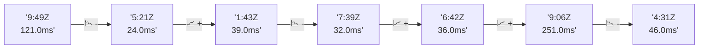

# 📊 Reporte de Performance - PokeAPI

**Fecha de corrida:** 2026-11-20 20:50 UTC

**Enlace:** [44814583860](https://github.com/rba3/Lab_CD_CI_Perfomance/actions/runs/44814583860)

## ✅ Veredicto

```
PASS (fallback por umbrales)

- Error maximo: 0.01%
- p95 maximo: 44.0 ms
```

## 🔮 Predicciones

⚠️ **Tendencia de degradación detectada** (LOW risk)
- Pendiente: +1.75ms/corrida
- P95 actual: 27.0ms
- Días hasta WARN: ~441
- Días hasta FAIL: ~841
- Confianza: 80%

## 📈 Métricas Globales

| Métrica | Valor | SLO | Estado |
|---------|-------|-----|--------|
| Error Rate | 0.01% | < 0.1% | ✅ PASS |
| Latencia p50 | 19.0ms | - | ℹ️ |
| Latencia p95 | 27.0ms | < 800ms | ✅ PASS |
| Latencia p99 | 40.0ms | - | ℹ️ |
| Throughput | 0.00 req/s | - | ℹ️ |
| Muestras | 0 | - | ℹ️ |

## 📉 Tendencia Histórica (Últimas 7 corridas)



## 🔧 Análisis Técnico Detallado (JSON)

```json
{
  "predictions": {
    "prediction": "DEGRADATION_TREND",
    "confidence": 80,
    "slope_ms_per_run": 1.75,
    "current_p95": 27.0,
    "days_to_warn": 441,
    "days_to_fail": 841,
    "risk_level": "LOW"
  },
  "recommendations": [],
  "correlations": {},
  "root_cause": {
    "issue": null,
    "root_cause": null,
    "confidence": 0,
    "evidence": []
  },
  "timestamp": "2026-11-20T20:50:46.264242"
}
```

## 📦 Datos Completos (JSON)

```json
{
  "scenario": "load",
  "overall": {
    "samples": 16422,
    "errors": 1,
    "error_pct": 0.01,
    "avg_ms": 20.0,
    "min_ms": 13,
    "max_ms": 388,
    "p50_ms": 19.0,
    "p90_ms": 24.0,
    "p95_ms": 27.0,
    "p99_ms": 40.0,
    "throughput_rps": 137.24,
    "duration_s": 119.7
  },
  "by_endpoint": {
    "ability-static": {
      "samples": 1643,
      "errors": 0,
      "error_pct": 0.0,
      "avg_ms": 19.3,
      "min_ms": 13,
      "max_ms": 80,
      "p50_ms": 18.0,
      "p90_ms": 23.0,
      "p95_ms": 25.0,
      "p99_ms": 32.6,
      "throughput_rps": 13.87,
      "duration_s": 118.4
    },
    "berry-cheri": {
      "samples": 1642,
      "errors": 0,
      "error_pct": 0.0,
      "avg_ms": 18.2,
      "min_ms": 13,
      "max_ms": 94,
      "p50_ms": 17.0,
      "p90_ms": 21.0,
      "p95_ms": 24.0,
      "p99_ms": 36.6,
      "throughput_rps": 13.87,
      "duration_s": 118.3
    },
    "generation-1": {
      "samples": 1642,
      "errors": 0,
      "error_pct": 0.0,
      "avg_ms": 19.1,
      "min_ms": 13,
      "max_ms": 77,
      "p50_ms": 18.0,
      "p90_ms": 22.0,
      "p95_ms": 24.0,
      "p99_ms": 32.6,
      "throughput_rps": 13.9,
      "duration_s": 118.1
    },
    "move-tackle": {
      "samples": 1642,
      "errors": 0,
      "error_pct": 0.0,
      "avg_ms": 19.9,
      "min_ms": 14,
      "max_ms": 66,
      "p50_ms": 19.0,
      "p90_ms": 23.0,
      "p95_ms": 25.9,
      "p99_ms": 49.0,
      "throughput_rps": 13.9,
      "duration_s": 118.1
    },
    "pokemon-charizard": {
      "samples": 1642,
      "errors": 0,
      "error_pct": 0.0,
      "avg_ms": 24.5,
      "min_ms": 18,
      "max_ms": 227,
      "p50_ms": 23.0,
      "p90_ms": 28.0,
      "p95_ms": 32.0,
      "p99_ms": 46.0,
      "throughput_rps": 13.8,
      "duration_s": 119.0
    },
    "pokemon-ditto": {
      "samples": 1642,
      "errors": 0,
      "error_pct": 0.0,
      "avg_ms": 19.3,
      "min_ms": 14,
      "max_ms": 268,
      "p50_ms": 18.0,
      "p90_ms": 22.0,
      "p95_ms": 24.0,
      "p99_ms": 36.2,
      "throughput_rps": 13.74,
      "duration_s": 119.5
    },
    "pokemon-list": {
      "samples": 1642,
      "errors": 0,
      "error_pct": 0.0,
      "avg_ms": 18.3,
      "min_ms": 13,
      "max_ms": 165,
      "p50_ms": 17.0,
      "p90_ms": 21.0,
      "p95_ms": 24.0,
      "p99_ms": 38.0,
      "throughput_rps": 13.84,
      "duration_s": 118.7
    },
    "pokemon-pikachu": {
      "samples": 1643,
      "errors": 0,
      "error_pct": 0.0,
      "avg_ms": 23.8,
      "min_ms": 17,
      "max_ms": 94,
      "p50_ms": 23.0,
      "p90_ms": 28.0,
      "p95_ms": 32.0,
      "p99_ms": 43.0,
      "throughput_rps": 13.79,
      "duration_s": 119.1
    },
    "type-fire": {
      "samples": 1642,
      "errors": 1,
      "error_pct": 0.06,
      "avg_ms": 19.2,
      "min_ms": 13,
      "max_ms": 388,
      "p50_ms": 18.0,
      "p90_ms": 22.0,
      "p95_ms": 24.0,
      "p99_ms": 35.2,
      "throughput_rps": 13.86,
      "duration_s": 118.5
    },
    "type-water": {
      "samples": 1642,
      "errors": 0,
      "error_pct": 0.0,
      "avg_ms": 18.8,
      "min_ms": 13,
      "max_ms": 169,
      "p50_ms": 18.0,
      "p90_ms": 22.0,
      "p95_ms": 23.0,
      "p99_ms": 35.2,
      "throughput_rps": 13.84,
      "duration_s": 118.7
    }
  },
  "empty": false
}
```

---

*Reporte generado automáticamente por el workflow de performance.*

*Timestamp: 2026-11-20T20:50:46.264958Z*
