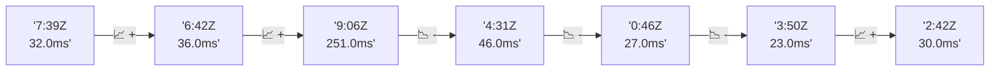

# 📊 Reporte de Performance - PokeAPI

**Fecha de corrida:** 2026-11-24 00:28 UTC

**Enlace:** [45297075103](https://github.com/rba3/Lab_CD_CI_Perfomance/actions/runs/45297075103)

## ✅ Veredicto

```
PASS (fallback por umbrales)

- Error maximo: 0.0%
- p95 maximo: 40.8 ms
```

## 🔮 Predicciones

✓ STABLE

## 📈 Métricas Globales

| Métrica | Valor | SLO | Estado |
|---------|-------|-----|--------|
| Error Rate | 0.0% | < 0.1% | ✅ PASS |
| Latencia p50 | 27.0ms | - | ℹ️ |
| Latencia p95 | 37.0ms | < 800ms | ✅ PASS |
| Latencia p99 | 69.0ms | - | ℹ️ |
| Throughput | 0.00 req/s | - | ℹ️ |
| Muestras | 0 | - | ℹ️ |

## 📉 Tendencia Histórica (Últimas 7 corridas)



## 🔧 Análisis Técnico Detallado (JSON)

```json
{
  "predictions": {
    "prediction": "STABLE",
    "confidence": 0,
    "slope_ms_per_run": -55.25,
    "current_p95": 37.0,
    "days_to_warn": null,
    "days_to_fail": null,
    "risk_level": "LOW"
  },
  "recommendations": [],
  "correlations": {},
  "root_cause": {
    "issue": null,
    "root_cause": null,
    "confidence": 0,
    "evidence": []
  },
  "timestamp": "2026-11-24T00:28:43.143832"
}
```

## 📦 Datos Completos (JSON)

```json
{
  "scenario": "load",
  "overall": {
    "samples": 15941,
    "errors": 0,
    "error_pct": 0.0,
    "avg_ms": 29.7,
    "min_ms": 22,
    "max_ms": 562,
    "p50_ms": 27.0,
    "p90_ms": 35.0,
    "p95_ms": 37.0,
    "p99_ms": 69.0,
    "throughput_rps": 133.24,
    "duration_s": 119.6
  },
  "by_endpoint": {
    "ability-static": {
      "samples": 1594,
      "errors": 0,
      "error_pct": 0.0,
      "avg_ms": 27.9,
      "min_ms": 23,
      "max_ms": 176,
      "p50_ms": 27.0,
      "p90_ms": 30.0,
      "p95_ms": 32.0,
      "p99_ms": 72.0,
      "throughput_rps": 13.47,
      "duration_s": 118.3
    },
    "berry-cheri": {
      "samples": 1593,
      "errors": 0,
      "error_pct": 0.0,
      "avg_ms": 27.6,
      "min_ms": 22,
      "max_ms": 120,
      "p50_ms": 27.0,
      "p90_ms": 31.0,
      "p95_ms": 33.0,
      "p99_ms": 47.0,
      "throughput_rps": 13.47,
      "duration_s": 118.2
    },
    "generation-1": {
      "samples": 1594,
      "errors": 0,
      "error_pct": 0.0,
      "avg_ms": 27.9,
      "min_ms": 23,
      "max_ms": 103,
      "p50_ms": 27.0,
      "p90_ms": 31.0,
      "p95_ms": 32.0,
      "p99_ms": 60.0,
      "throughput_rps": 13.51,
      "duration_s": 118.0
    },
    "move-tackle": {
      "samples": 1593,
      "errors": 0,
      "error_pct": 0.0,
      "avg_ms": 29.5,
      "min_ms": 23,
      "max_ms": 178,
      "p50_ms": 28.0,
      "p90_ms": 32.0,
      "p95_ms": 34.0,
      "p99_ms": 84.1,
      "throughput_rps": 13.5,
      "duration_s": 118.0
    },
    "pokemon-charizard": {
      "samples": 1595,
      "errors": 0,
      "error_pct": 0.0,
      "avg_ms": 37.1,
      "min_ms": 29,
      "max_ms": 562,
      "p50_ms": 35.0,
      "p90_ms": 40.0,
      "p95_ms": 44.0,
      "p99_ms": 74.0,
      "throughput_rps": 13.4,
      "duration_s": 119.1
    },
    "pokemon-ditto": {
      "samples": 1595,
      "errors": 0,
      "error_pct": 0.0,
      "avg_ms": 29.0,
      "min_ms": 23,
      "max_ms": 276,
      "p50_ms": 27.0,
      "p90_ms": 31.0,
      "p95_ms": 34.0,
      "p99_ms": 76.1,
      "throughput_rps": 13.34,
      "duration_s": 119.6
    },
    "pokemon-list": {
      "samples": 1594,
      "errors": 0,
      "error_pct": 0.0,
      "avg_ms": 26.9,
      "min_ms": 22,
      "max_ms": 176,
      "p50_ms": 26.0,
      "p90_ms": 29.0,
      "p95_ms": 31.0,
      "p99_ms": 40.0,
      "throughput_rps": 13.44,
      "duration_s": 118.6
    },
    "pokemon-pikachu": {
      "samples": 1595,
      "errors": 0,
      "error_pct": 0.0,
      "avg_ms": 36.7,
      "min_ms": 28,
      "max_ms": 466,
      "p50_ms": 34.0,
      "p90_ms": 38.0,
      "p95_ms": 42.0,
      "p99_ms": 118.1,
      "throughput_rps": 13.39,
      "duration_s": 119.1
    },
    "type-fire": {
      "samples": 1594,
      "errors": 0,
      "error_pct": 0.0,
      "avg_ms": 26.7,
      "min_ms": 23,
      "max_ms": 74,
      "p50_ms": 26.0,
      "p90_ms": 29.0,
      "p95_ms": 31.0,
      "p99_ms": 55.0,
      "throughput_rps": 13.46,
      "duration_s": 118.5
    },
    "type-water": {
      "samples": 1594,
      "errors": 0,
      "error_pct": 0.0,
      "avg_ms": 27.3,
      "min_ms": 23,
      "max_ms": 263,
      "p50_ms": 26.0,
      "p90_ms": 29.0,
      "p95_ms": 31.0,
      "p99_ms": 66.1,
      "throughput_rps": 13.44,
      "duration_s": 118.6
    }
  },
  "empty": false
}
```

---

*Reporte generado automáticamente por el workflow de performance.*

*Timestamp: 2026-11-24T00:28:43.144648Z*
