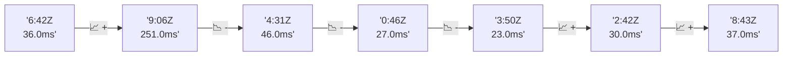

# 📊 Reporte de Performance - PokeAPI

**Fecha de corrida:** 2026-11-24 22:51 UTC

**Enlace:** [45504346463](https://github.com/rba3/Lab_CD_CI_Perfomance/actions/runs/45504346463)

## ✅ Veredicto

```
PASS (fallback por umbrales)

- Error maximo: 0.0%
- p95 maximo: 26.0 ms
```

## 🔮 Predicciones

✓ STABLE

## 📈 Métricas Globales

| Métrica | Valor | SLO | Estado |
|---------|-------|-----|--------|
| Error Rate | 0.0% | < 0.1% | ✅ PASS |
| Latencia p50 | 12.0ms | - | ℹ️ |
| Latencia p95 | 22.0ms | < 800ms | ✅ PASS |
| Latencia p99 | 35.0ms | - | ℹ️ |
| Throughput | 0.00 req/s | - | ℹ️ |
| Muestras | 0 | - | ℹ️ |

## 📉 Tendencia Histórica (Últimas 7 corridas)



## 🔧 Análisis Técnico Detallado (JSON)

```json
{
  "predictions": {
    "prediction": "STABLE",
    "confidence": 0,
    "slope_ms_per_run": -2.25,
    "current_p95": 22.0,
    "days_to_warn": null,
    "days_to_fail": null,
    "risk_level": "LOW"
  },
  "recommendations": [],
  "correlations": {},
  "root_cause": {
    "issue": null,
    "root_cause": null,
    "confidence": 0,
    "evidence": []
  },
  "timestamp": "2026-11-24T22:51:16.519440"
}
```

## 📦 Datos Completos (JSON)

```json
{
  "scenario": "load",
  "overall": {
    "samples": 16757,
    "errors": 0,
    "error_pct": 0.0,
    "avg_ms": 13.5,
    "min_ms": 6,
    "max_ms": 2993,
    "p50_ms": 12.0,
    "p90_ms": 18.0,
    "p95_ms": 22.0,
    "p99_ms": 35.0,
    "throughput_rps": 140.11,
    "duration_s": 119.6
  },
  "by_endpoint": {
    "ability-static": {
      "samples": 1675,
      "errors": 0,
      "error_pct": 0.0,
      "avg_ms": 12.6,
      "min_ms": 6,
      "max_ms": 117,
      "p50_ms": 11.0,
      "p90_ms": 18.0,
      "p95_ms": 21.0,
      "p99_ms": 31.0,
      "throughput_rps": 14.16,
      "duration_s": 118.3
    },
    "berry-cheri": {
      "samples": 1675,
      "errors": 0,
      "error_pct": 0.0,
      "avg_ms": 14.6,
      "min_ms": 6,
      "max_ms": 2993,
      "p50_ms": 11.0,
      "p90_ms": 18.0,
      "p95_ms": 23.0,
      "p99_ms": 36.0,
      "throughput_rps": 14.16,
      "duration_s": 118.3
    },
    "generation-1": {
      "samples": 1675,
      "errors": 0,
      "error_pct": 0.0,
      "avg_ms": 13.1,
      "min_ms": 6,
      "max_ms": 161,
      "p50_ms": 11.0,
      "p90_ms": 18.0,
      "p95_ms": 22.0,
      "p99_ms": 37.0,
      "throughput_rps": 14.19,
      "duration_s": 118.0
    },
    "move-tackle": {
      "samples": 1676,
      "errors": 0,
      "error_pct": 0.0,
      "avg_ms": 13.4,
      "min_ms": 7,
      "max_ms": 107,
      "p50_ms": 12.0,
      "p90_ms": 18.0,
      "p95_ms": 22.0,
      "p99_ms": 32.2,
      "throughput_rps": 14.18,
      "duration_s": 118.2
    },
    "pokemon-charizard": {
      "samples": 1676,
      "errors": 0,
      "error_pct": 0.0,
      "avg_ms": 16.1,
      "min_ms": 7,
      "max_ms": 82,
      "p50_ms": 15.0,
      "p90_ms": 21.0,
      "p95_ms": 24.0,
      "p99_ms": 42.0,
      "throughput_rps": 14.08,
      "duration_s": 119.0
    },
    "pokemon-ditto": {
      "samples": 1676,
      "errors": 0,
      "error_pct": 0.0,
      "avg_ms": 13.0,
      "min_ms": 6,
      "max_ms": 245,
      "p50_ms": 11.0,
      "p90_ms": 18.0,
      "p95_ms": 23.0,
      "p99_ms": 34.0,
      "throughput_rps": 14.02,
      "duration_s": 119.5
    },
    "pokemon-list": {
      "samples": 1676,
      "errors": 0,
      "error_pct": 0.0,
      "avg_ms": 11.7,
      "min_ms": 6,
      "max_ms": 113,
      "p50_ms": 11.0,
      "p90_ms": 16.0,
      "p95_ms": 18.0,
      "p99_ms": 30.2,
      "throughput_rps": 14.12,
      "duration_s": 118.7
    },
    "pokemon-pikachu": {
      "samples": 1676,
      "errors": 0,
      "error_pct": 0.0,
      "avg_ms": 15.2,
      "min_ms": 7,
      "max_ms": 258,
      "p50_ms": 14.0,
      "p90_ms": 19.5,
      "p95_ms": 23.0,
      "p99_ms": 40.0,
      "throughput_rps": 14.08,
      "duration_s": 119.0
    },
    "type-fire": {
      "samples": 1676,
      "errors": 0,
      "error_pct": 0.0,
      "avg_ms": 12.9,
      "min_ms": 6,
      "max_ms": 160,
      "p50_ms": 12.0,
      "p90_ms": 17.0,
      "p95_ms": 20.0,
      "p99_ms": 31.0,
      "throughput_rps": 14.15,
      "duration_s": 118.5
    },
    "type-water": {
      "samples": 1676,
      "errors": 0,
      "error_pct": 0.0,
      "avg_ms": 12.6,
      "min_ms": 6,
      "max_ms": 77,
      "p50_ms": 11.5,
      "p90_ms": 17.0,
      "p95_ms": 19.0,
      "p99_ms": 30.0,
      "throughput_rps": 14.12,
      "duration_s": 118.7
    }
  },
  "empty": false
}
```

---

*Reporte generado automáticamente por el workflow de performance.*

*Timestamp: 2026-11-24T22:51:16.520208Z*
